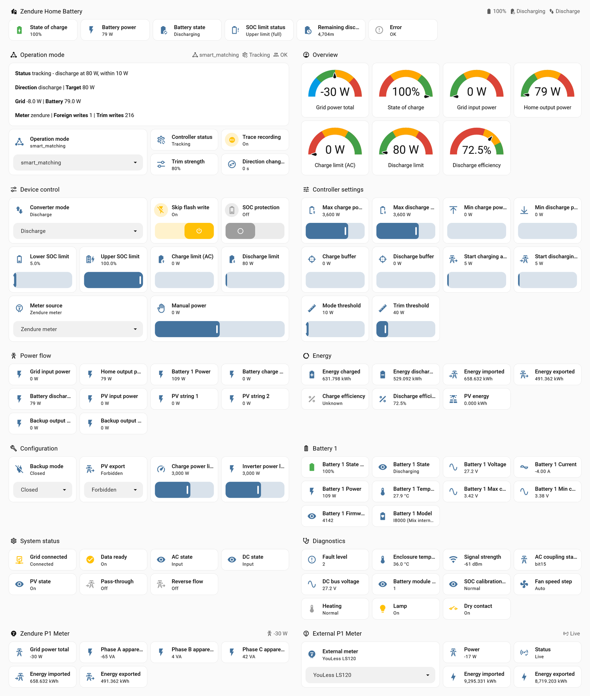
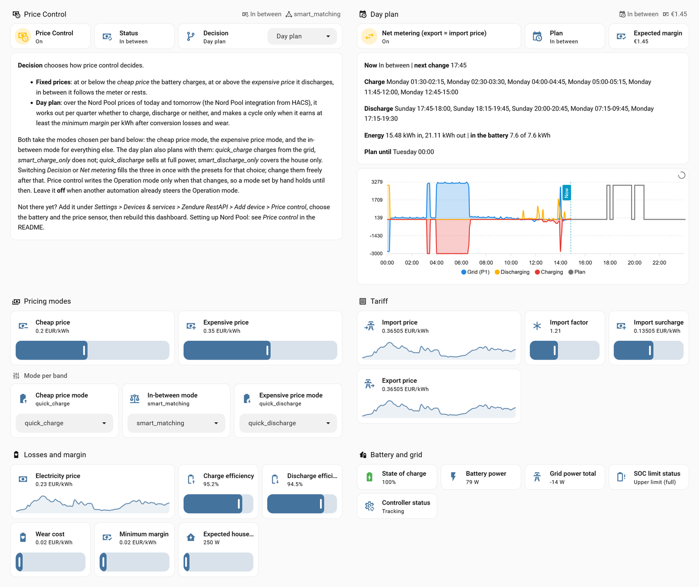

# Zendure RestAPI – Home Assistant-integratie

    

🇬🇧 [English version](README.md) · 🇩🇪 [Deutsche Version](README.de.md)

**Je Zendure SolarFlow-thuisbatterij in Home Assistant, 100% lokaal, in drie stappen.** Geen cloudaccount, geen MQTT-broker, geen YAML-packages om te kopiëren. Installeer via HACS, voeg je accu toe, kies een modus — de accu houdt je netaansluiting op nul, elke seconde: nul op de meter.

**🔌 Works with HomeWizard.** Heb je al een HomeWizard P1-meter? Meer heb je niet nodig — een Zendure-meter is niet vereist. YouLess, EcoTracker, Shelly Pro 3EM en de Zendure-meters werken ook.

**💶 Dynamische tarieven, ingebouwd.** Heb je een dynamisch contract, zoals Zonneplan, Tibber, Frank Energie of ANWB Energie? Price Control plant laden en ontladen per kwartier over de prijzen van vandaag en morgen (Nord Pool, EPEX Spot, Zonneplan) — import- en exportprijs, omzetverlies en slijtage meegerekend. Salderen zit erin: zolang het geldt één schakelaar aan, vanaf 2027 uit. Geen automation te schrijven: zet hem aan.

*`smart_matching` zet het zonne-overschot in de accu: die laadt met 902 W en de regeling houdt het net binnen 10 W van nul, met de externe meter als stuurmeter. De integratie maakt dit dashboard voor je aan, met nog twee tabbladen: Price Control en History.*

**Snel aan de slag hieronder** · alle details in de [Technische referentie](#-technische-referentie) (Engels)

---

## 📌 Ondersteunde apparaten

| Apparaat | Status |
|---|---|
| **SolarFlow 3000 Mix AC+** | ✅ Dagelijks getest door de maker |
| **SolarFlow 4000 Mix AC+** | ✅ Ondersteund — zelfde platform en accu als de 3000 Mix |
| **SolarFlow 2400 AC** | ✅ Getest door een gebruiker — uitlezen en `smart_matching` bevestigd |
| **SolarFlow 2400 AC+** | ✅ Getest door een gebruiker — uitlezen met een Zendure Smart Meter 3CT |
| **SolarFlow 1600 AC+** | ✅ Ondersteund — zelfde AC-gekoppelde opbouw als de 2400 AC |
| **SolarFlow 800 · 800 Plus · 800 Pro · 800 Pro 2 · 2400 Pro** | 🧪 Werkt, slimme modi experimenteel (zonnepanelen op het apparaat) |
| **SolarFlow 4000 Mix Pro** | 🧪 Werkt, slimme modi experimenteel (zonnepanelen op het apparaat) |
| Hyper 2000 · Hub 1200/2000 · AIO 2400 · Ace 1500 | ❌ Geen lokale API op deze modellen |

**🙋 Heb je een model met ✅ of 🧪? Dan ben jij precies wie dit project nodig heeft.** Installeer het, en als er iets niet klopt — of als alles gewoon werkt — open een [New model report](https://github.com/windsurf/hassio-zendure-restapi/issues/new?template=new_model.yml) met de diagnostics-download als bijlage. Eén melding is genoeg om een model van 🧪 naar ✅ te brengen.

---

## 🔌 Ondersteunde meters

De accu moet weten wat je huis van het net haalt of terug levert. Gebruik de meter die je al hebt.

| Meter | Status |
|---|---|
| **HomeWizard P1-meter** (lokale API v1) | ✅ **Works with HomeWizard** — wordt automatisch gevonden op je netwerk; gedocumenteerde lokale API, elke seconde gelezen |
| **YouLess LS120** | ✅ Gemeten door de maker — ziet elke lastsprong tot een seconde eerder dan de Zendure-meter |
| **Zendure P1-meter** | ✅ Dagelijks getest door de maker |
| **Zendure Smart Meter 3CT** | 🧪 Zelfde API als de Zendure P1-meter |
| **EcoTracker** (everHome) | 🧪 Gedocumenteerde lokale API, één meting per seconde |
| **Shelly Pro 3EM** (klemmen op de netaansluiting) | ✅ Getest door een gebruiker als netmeter voor de regeling, één meting per seconde |
| **Elke meter in Home Assistant** (Shelly, DSMR, SMA, Huawei, Zonneplan, …) | 🧪 Kies het apparaat, de sensoren worden herkend (v1.6.5); regelt alleen als hij elke seconde of twee ververst |

In één keer ingesteld: **Integratie toevoegen → Zendure RestAPI → Externe netmeter via IP**, kies je meter en vul het IP-adres in. Een HomeWizard P1-meter verschijnt vanzelf onder *Ontdekt*. Hij wordt een eigen apparaat met sensoren voor vermogen, status en energie, en omdat de select **Meter source** op `auto` staat, gebruikt de accu hem meteen. HomeWizard: zet eerst *Lokale API* aan in de HomeWizard Energy-app.

*Niet gelieerd aan HomeWizard, YouLess, everHome of Shelly; dit zijn compatibiliteitsnotities.*

---

## Waarom deze integratie

- **100% lokaal.** Praat rechtstreeks met de eigen HTTP-server van de accu op je netwerk. Blijft werken als internet of de Zendure-cloud dat niet doet.
- **Nul-teruglevering, elke seconde.** Een snelle lus volgt je meter elke seconde; een tragere regelt de richting en de veiligheid. Gebouwd en afgesteld op metingen, niet op aannames.
- **Zeven werkmodi** — van rustig `standby` tot `smart_matching`, alleen laden, alleen ontladen, snel laden/ontladen en handmatig. Stuur ze met de hand, met Price Control of met je eigen automation.
- **Dynamische tarieven, ingebouwd.** Price Control stuurt de accu op twee vaste prijzen of op een dagplan over de prijzen van vandaag en morgen — zie [Prijssturing](#-prijssturing).
- **Blijft werken als het web het laat afweten.** De sturing draait lokaal in je netwerk, zonder cloud. Prijzen kunnen uit Nord Pool of EPEX Spot komen, die doorwerkten terwijl webdiensten offline gingen voor de noodpatches van PHP2Shell.
- **Instellingen zijn entiteiten.** Elke instelling overleeft een herstart en is live aan te passen vanaf het dashboard of vanuit een automation. Updates via HACS laten je eigen configuratie met rust.
- **Je eigen meter.** HomeWizard, YouLess, EcoTracker, Shelly Pro 3EM of Zendure — gevonden op je netwerk of toegevoegd op IP-adres, rechtstreeks gelezen, elke seconde, niet via een tragere Home Assistant-sensor. Of elke vermogenssensor die Home Assistant al heeft.
- **Veilig ontworpen.** Geen geldige meterwaarde, geen beweging: de accu stopt. Twee accu's vechten nooit om dezelfde meter; elke accu heeft zijn eigen regelaar, meterkeuze en prijssturing.
- **Laag sluimerverbruik, gemeten.** Geeft de accu terug aan zijn zuinige stand als er niets te doen is: ongeveer 5 W in plaats van 29–36 W (Backup mode `closed`), elk uur dat hij stilstaat.
- **Spaart het flashgeheugen.** De slimme modi schrijven hun limieten naar het werkgeheugen, niet naar flash — tienduizenden schrijfacties per jaar die het apparaat niet slijten.
- **Laat een volle accu met rust.** Op de eigen SOC-grenzen van het apparaat wordt niets in de dichte richting besteld: een hele nacht op 100% kostte twee limietwijzigingen, en de status zegt waarom.
- **Alles zichtbaar.** Kant-en-klaar dashboard, een controllerstatus die zegt *waarom*, laad- en ontlaadrendement als sensoren, en een optionele CSV-trace per seconde voor wie het precies wil weten.
- **Elke wijziging gemeten vóór de release.** Wijzigingen aan de regellus worden eerst nagespeeld op opgenomen meetreeksen per seconde; de metingen en de correcties op Zendures documentatie staan openbaar in de technische referentie.
- **Spreekt je taal.** Instelschermen, entiteitsnamen en statussen in het Nederlands, Engels, Duits, Frans, Italiaans, Spaans, Portugees, Pools, Tsjechisch, Zweeds en Deens.

---

## 🚀 Aan de slag

**1. Zet de lokale API aan en de eigen sturing van Zendure uit** — onder EN 18031 staat de API standaard uit. In de Zendure-app:
- voeg **HEMS** toe — dat zet de lokale API aan;
- zet op de apparaatpagina **Add to HEMS** uit — dan blijft de eigen sturing van Zendure buiten spel. Andere manieren en de vermogensinstellingen van de app: [Before you start](https://github.com/windsurf/hassio-zendure-restapi/blob/main/README2.md#before-you-start).

Sluit de app daarna af. Controleer het vanuit een browser: `http://<ip-accu>/properties/report` moet een resultaat in JSON-formaat tonen: tekst tussen accolades `{ … }` met `"properties"` erin.

**2. Installeer via HACS**

Of: HACS → menu met drie puntjes → Aangepaste repositories → `https://github.com/windsurf/hassio-zendure-restapi`, categorie **Integratie**. Installeer **Zendure RestAPI** en herstart Home Assistant.

**3. Voeg je apparaten toe** Home Assistant vindt de accu en de P1-meter meestal zelf, onder **Instellingen → Apparaten & diensten**. Anders: voeg **Zendure RestAPI** toe, kies **Zendure-accu** (de eerste optie) en vul het IP-adres in. Het dashboard **Zendure RestAPI** verschijnt vanzelf in je zijbalk; een bestaand dashboard blijft ongemoeid. Zet **Operation mode** op `smart_matching` en zie het net naar nul gaan.

**Je meter:** een HomeWizard P1-meter staat klaar onder *Ontdekt*; klik **Toevoegen**. Andere meters: **Integratie toevoegen → Zendure RestAPI → Externe netmeter via IP**, kies YouLess, EcoTracker, Shelly of Zendure en vul het IP-adres in. Een meter die al in Home Assistant zit: **Externe netmeter uit Home Assistant**. Klaar — `auto` pakt hem op. Een Zendure P1-meter wordt gevonden als eigen apparaat en vraagt verder niets.

---

## Werkmodi

De namen van de modi blijven in elke taal gelijk, zodat automations en documentatie ernaar kunnen verwijzen.

| Modus | Wat de accu doet |
|---|---|
| `standby` | Niets — stopt één keer en laat het apparaat daarna met rust |
| `smart_matching` | Laadt bij overschot en ontlaadt bij vraag, en houdt het net op nul |
| `smart_charge_only` | Neemt alleen overschot op, ontlaadt nooit |
| `smart_discharge_only` | Dekt alleen vraag, laadt nooit |
| `quick_charge` / `quick_discharge` | Vol vermogen, los van de meter |
| `manual` | Volgt een vast instelpunt |

---

## 💶 Prijssturing

*Het tabblad Price Control: het dagplan voor vandaag en morgen, gemeten tot nu en gepland daarna, welke kwartieren laden en welke ontladen, en de verwachte marge. Met salderen aan volgt de terugleverprijs de afnameprijs.*

Twee manieren om de accu te sturen op een dynamisch tarief, in een eigen apparaat:

- **Vaste prijzen** — op of onder een **goedkope prijs** laadt de accu (uit het net, of alleen van zon), op of boven een **dure prijs** ontlaadt hij, daartussen houdt hij het net op nul (de modi per band kies je zelf). Elke prijssensor werkt: Nord Pool, EnergyZero, Zonneplan, Tibber, Frank Energie of je eigen.
- **Dagplan** (nieuw in v1.6.0) — over de prijzen van vandaag en morgen van [Nord Pool](https://github.com/custom-components/nordpool), EPEX Spot of Zonneplan bepaalt het per kwartier of de accu laadt, ontlaadt of geen van beide, met aparte import- en exportprijzen, omzetverlies, slijtage en een minimale marge per kWh. Standaard handelt het: laden en ontladen op het volle vermogen van de accu; met de modi per band dekt het desgewenst alleen het huis of laadt het alleen van zon. Klaar voor het einde van de saldering in 2027: zet *Net metering* uit en de exportprijs volgt zijn eigen formule.

Teruggespeeld op 30 dagen van een echte installatie leverde het dagplan **€ 1,58 per dag** op — evenveel als een volledige energieplanner op dezelfde dagen; de vaste prijzen € 0,21.

**Dagplan — twee voorwaarden uit HACS:** **Nord Pool** voor de prijzen, **ApexCharts Card** voor de grafiek.

1. Installeer **Nord Pool** ([open in HACS](https://my.home-assistant.io/redirect/hacs_repository/?owner=custom-components&repository=nordpool&category=integration)) en **ApexCharts Card** ([open in HACS](https://my.home-assistant.io/redirect/hacs_repository/?owner=RomRider&repository=apexcharts-card&category=plugin)); herstart Home Assistant en ververs de browser.
2. **Integratie toevoegen → Nord Pool**: *Region* je prijsgebied (`NL` voor Nederland), *Currency* `EUR`, *Include VAT* aan, *Price in cents* uit, *Energy scale* `kWh`, *Template for additional costs* laten staan.
3. Voeg Prijssturing toe (hieronder) met die sensor, `sensor.nordpool_kwh_…`, en zet *De prijssensor bevat* op **Spotprijs incl. btw**.
4. Zet **Beslissing** op **Dagplan** en zet tot 1 januari 2027 **Salderen** aan. Vergelijk **Importprijs** met de prijs van je leverancier voor dit kwartier; wijkt hij af, pas dan *Importopslag* aan.

**EPEX Spot of Zonneplan in plaats van Nord Pool?** Installeer in stap 1 alleen ApexCharts Card en sla stap 2 over. Kies in stap 3 de prijssensor van EPEX Spot of Zonneplan, met *The price sensor holds* zoals bij die integratie staat in [Other price sources](https://github.com/windsurf/hassio-zendure-restapi/blob/main/README2.md#other-price-sources-epex-spot-zonneplan-and-more) (Engels).

Volledige uitleg, tariefinstellingen voor andere contracten en landen: [Setting up Nord Pool](https://github.com/windsurf/hassio-zendure-restapi/blob/main/README2.md#setting-up-nord-pool-for-the-day-plan) (Engels).

**Toevoegen:** **Integratie toevoegen → Zendure RestAPI → Prijssturing**, kies de accu en je prijssensor. Het apparaat **Price Control** verschijnt naast je accu; zet het daar aan. Elke instelling is live aan te passen, op dat apparaat of op het tabblad *Price Control* van het dashboard.

Standaard uit, en hij schrijft de werkmodus alleen als de beslissing verandert, dus een modus die je met de hand zet blijft staan. Stuurt een eigen automation of planner de werkmodus al, laat hem dan uit. Details in de [technische referentie](https://github.com/windsurf/hassio-zendure-restapi/blob/main/README2.md#price-control) (Engels).

---

## 📏 Gemeten op het referentieapparaat

SolarFlow 3000 Mix AC+, één intern accupakket. Methode en ruwe cijfers in de technische referentie (Engels).

| | Gemeten |
|---|---|
| [Laadrendement](https://github.com/windsurf/hassio-zendure-restapi/blob/main/README2.md#conversion-efficiency) bij 3 kW, AC → cellen | **95,2%** (drie vensters, 95,1–95,2%) |
| [Ontlaadverlies](https://github.com/windsurf/hassio-zendure-restapi/blob/main/README2.md#conversion-efficiency) | vast ~33 W plus 97,4% omzetting — 95%+ bij hoog vermogen, 81–84% bij 100–200 W |
| [Bruikbare capaciteit](https://github.com/windsurf/hassio-zendure-restapi/blob/main/README2.md#usable-capacity) | **8,8 kWh** aan de cellen; 9,3 kWh aan de AC-aansluiting voor 0 → 100% |
| [Sluimerverbruik](https://github.com/windsurf/hassio-zendure-restapi/blob/main/README2.md#known-limitations) | 29–36 W zolang hij wakker is; ongeveer 5 W zodra `standby` hem laat slapen (Backup mode `closed`) |
| [Vertraging Zendure P1-meter](https://github.com/windsurf/hassio-zendure-restapi/blob/main/README2.md#the-delay) | 0,4–1,1 s achter een YouLess op dezelfde poort; herhaalt in 28% van de seconden zijn vorige waarde |

---

## 📖 Technische referentie

Alles wat op deze pagina ontbreekt staat in **[README2.md – Technical reference](https://github.com/windsurf/hassio-zendure-restapi/blob/main/README2.md)** (Engels):

- [Supported products](https://github.com/windsurf/hassio-zendure-restapi/blob/main/README2.md#-supported-products) — zekerheid per model en waar die op rust
- [Device support](https://github.com/windsurf/hassio-zendure-restapi/blob/main/README2.md#device-support) — wat er per model verschilt, en waarom zonnepanelen op het apparaat experimenteel zijn
- [How the controller works](https://github.com/windsurf/hassio-zendure-restapi/blob/main/README2.md#how-the-controller-works) — de twee lussen, de boekhouding, de beveiligingen
- [External meters](https://github.com/windsurf/hassio-zendure-restapi/blob/main/README2.md#an-external-p1-meter) — HomeWizard, YouLess, EcoTracker, Shelly Pro 3EM, Zendure 3CT
- [Languages](https://github.com/windsurf/hassio-zendure-restapi/blob/main/README2.md#languages) — elf talen, verbeteringen welkom
- [Supported entities](https://github.com/windsurf/hassio-zendure-restapi/blob/main/README2.md#supported-entities) en [The Energy dashboard](https://github.com/windsurf/hassio-zendure-restapi/blob/main/README2.md#the-energy-dashboard)
- [Debug logging en de voorbeeldtrace](https://github.com/windsurf/hassio-zendure-restapi/blob/main/README2.md#debug-logging)
- [zenSDK and this integration](https://github.com/windsurf/hassio-zendure-restapi/blob/main/README2.md#zensdk-and-this-integration) — wat de SDK van Zendure noemt, en wat deze integratie toevoegt en corrigeert
- [Changelog](https://github.com/windsurf/hassio-zendure-restapi/blob/main/README2.md#changelog)

**Laatste release – v1.6.7:** een kleinere database: energietellers worden per 0,01 kWh of eens per minuut geschreven, *Telegram age* is geen sensor meer, en de README legt uit hoe je de database klein houdt; de assen van de grafieken volgen de data en snijden geen lijn meer af. **v1.6.6:** een tabblad **History** met vier grafieken — 30 minuten live, 4 uur, de afgelopen 24 uur, 30 dagen dagtotalen; zon van een **micro-omvormer of tweede omvormer** is in de grafieken te tonen; het dashboard is vanuit de opties te **vervangen**. **v1.6.5:** het dashboard toont de netmeting waarop echt gestuurd wordt, **Netvermogen (in regeling)**, van welke meter ook; het dagplan leest ook **EPEX Spot**- en **Zonneplan**-prijzen; elke meter die al in Home Assistant zit is als heel apparaat te kiezen. **v1.6.4:** een **richtingswissel in één schrijfactie** in plaats van maximaal vier, en een nieuwe gemeten diagnostiek, **Verloren schrijfacties**, die elke limietschrijfactie toetst aan het volgende rapport van het apparaat; hoe snel het apparaat een schrijfactie volgt is gedocumenteerd; het setupmenu begint nu met de accu. **v1.6.3:** **gemeten diagnostiek** — wat de accu werkelijk doet, naast wat de instellingen aannemen: laad- en ontlaadrendement per blok, rondritrendement per cyclus, bruikbare capaciteit, volle cycli, standby-verbruik, reactietijd en regelafwijking, en de **gerealiseerde marge** per dag naast de verwachte; een waarschuwing als de accu in rust te veel verbruikt. **v1.6.2:** een waarschuwing als iets anders de accu ook aanstuurt (de Zendure-app niet op Aangepaste modus, of een eigen automation); prijssturing blijft schrijven na herladen of een trage herstart.

**Binnenkort in 1.7:** meerdere accu's achter één aansluiting als één cluster — testers met twee of meer Zendure-accu's zijn welkom in de [Discussions](https://github.com/windsurf/hassio-zendure-restapi/discussions).

## Meer

- 🐞 [Issues](https://github.com/windsurf/hassio-zendure-restapi/issues) — fouten, vragen en [modelmeldingen](https://github.com/windsurf/hassio-zendure-restapi/issues/new?template=new_model.yml). Nederlands mag.
- 💬 [Forumtopic](https://community.home-assistant.io/t/zendure-restapi-local-zero-export-control-for-solarflow-batteries/1029076) — vragen, opstellingen en ervaringen.
- ⭐ Nuttig? Een ster op deze repository helpt anderen hem te vinden.

---

> **Disclaimer:** Niet gelieerd aan of goedgekeurd door Zendure. Geleverd zoals het is, zonder garantie. Gebruik op eigen risico.

Licentie: MIT — zie [LICENSE](LICENSE).
