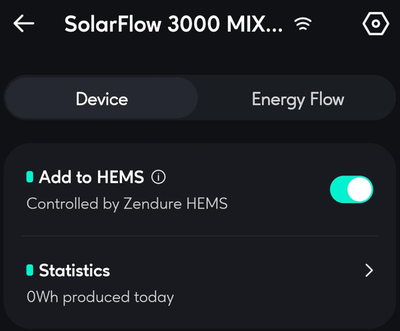
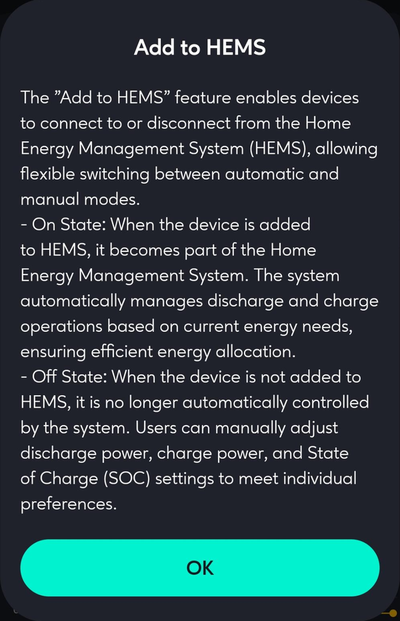
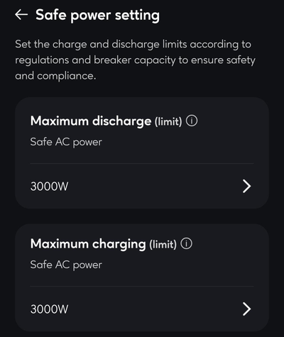
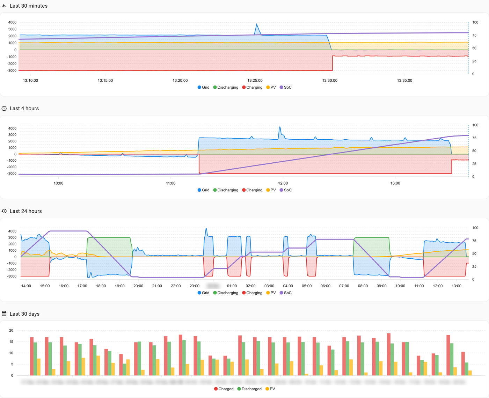

# Zendure RestAPI – Technical reference

*The short version with installation in three steps is in [README.md](README.md) — 🇳🇱 [Nederlands](README.nl.md) · 🇩🇪 [Deutsch](README.de.md). This page is the full reference: how the controller works, what was measured, every entity, and the changelog. Questions and experiences: the [forum topic](https://community.home-assistant.io/t/zendure-restapi-local-zero-export-control-for-solarflow-batteries/1029076).*

[](https://github.com/hacs/integration)
[](https://github.com/windsurf/hassio-zendure-restapi/releases)

> **Disclaimer:** This software is not affiliated with or endorsed by Zendure in any way. It is provided "as-is" without warranty or support, for the educational use of developers and enthusiasts. Use at your own risk.

Local monitoring and control of Zendure SolarFlow batteries over the zenSDK HTTP API, with the Zendure P1 meter, a HomeWizard P1 meter, a YouLess, an EcoTracker, a Shelly Pro 3EM, or any power sensor already in Home Assistant as grid reading. No cloud account, no MQTT broker, no Bluetooth pairing — the device runs a plain JSON REST server on your LAN and this integration talks to it directly.

Beyond reading the device, the integration runs an **operation-mode controller**: seven strategies that turn a price decision — by hand, from your own automation or from the built-in Price Control — into charge and discharge limits, tracking a linked meter towards zero grid exchange.

> **Actively tested with:** Zendure SolarFlow 3000 Mix AC+ (`solarFlow3000MixAC+`) and the Zendure P1 meter (three-phase, meterType 3)


*The example dashboard: `smart_matching` puts the solar surplus into the battery, charging at 902 W
while the controller keeps the grid within 10 W of zero on the external meter. Three views are
included — the battery, Price Control and History — see [Dashboard](#dashboard).*

---

## Contents

- **Install:** [Supported products](#-supported-products) · [Before you start](#before-you-start) · [Installation via HACS](#installation-via-hacs) · [Manual Installation](#manual-installation) · [Setup](#setup)
- **Use:** [Dashboard](#dashboard) · [Price control](#price-control) · [An external P1 meter](#an-external-p1-meter)
- **How it works:** [How the controller works](#how-the-controller-works) · [What the P1 meter does and does not give you](#what-the-p1-meter-does-and-does-not-give-you) · [zenSDK and this integration](#zensdk-and-this-integration) · [Notes on correctness](#notes-on-correctness)
- **Energy and measurements:** [The Energy dashboard](#the-energy-dashboard) · [Measured diagnostics](#measured-diagnostics)
- **Reference:** [Supported Entities](#supported-entities) · [The database](#the-database) · [Debug logging](#debug-logging) · [Reporting an unsupported property](#reporting-an-unsupported-property) · [Brand images](#brand-images) · [Known limitations](#known-limitations)
- **History:** [Coming in 1.7](#coming-in-17-clusters) · [Changelog](#changelog) · [Inspiration & Acknowledgements](#inspiration--acknowledgements) · [Disclaimer](#disclaimer) · [Licence](#licence)

---

## 📌 Supported products

Every SolarFlow on the local zenSDK API speaks the same protocol, so every model below can be installed and read out. What differs is how much of the control loop has been proven on it. Only the 3000 Mix AC+ has been run by the author; everything else rests on the shared protocol, Zendure's property documentation and Zendure's own Home Assistant integration, which drives these models over the same local API.

| Model | PV on the device | Confidence | Basis |
|---|---|---|---|
| SolarFlow 3000 Mix AC+ | no | **reference** | developed and measured on it |
| SolarFlow 4000 Mix AC+ | no | **high** | same platform and internal 8 kWh pack (`packType` 70); driven locally by Zendure's integration |
| SolarFlow 2400 AC | no | **tested** | user report: read-out complete, `smart_matching` with a Shelly Pro 3EM, follows limit writes within ~2 s |
| SolarFlow 2400 AC+, 1600 AC+ | no | **high** | listed by zenSDK; same AC-coupled layout as the 2400 AC |
| SolarFlow 800, 800 Plus, 800 Pro, 800 Pro 2, 2400 Pro | yes | **experimental** | same protocol, but the control loop has only run on a device without PV of its own — see [Device support](#device-support) |
| SolarFlow 4000 Mix Pro | yes | **experimental** | as above, and not yet in Zendure's own integration either |
| Zendure P1 meter | – | **reference** | the grid meter this integration was built on |
| YouLess LS120 (external grid meter) | – | **high** | measured against the Zendure meter, 0.4–1.1 s faster |
| HomeWizard P1 meter, API v1 (external grid meter) | – | **high** | documented local API, read every second |
| Shelly Pro 3EM (external grid meter) | – | **tested** | user report: grid meter for the control loop, 11,350 readings, 3 failures |
| EcoTracker (external grid meter) | – | **experimental** | documented local API |
| Smart Meter 3CT | – | **experimental** | reports no `meterType`; recognised as a meter by its fields since v1.6.7, user report (issue #7). Same `/properties/report` and `total_power` as the P1 meter; can also be read as external meter type *Zendure* |
| Hyper 2000, Hub 1200/2000, AIO 2400, Ace 1500 | – | **not possible** | no local HTTP API; MQTT or Bluetooth only |

**Own one of these?** Every model above the line *not possible* is worth trying — install it, and open a
[New model report](https://github.com/windsurf/hassio-zendure-restapi/issues/new?template=new_model.yml)
with the diagnostics download attached, whether it works or not. One report is enough to move a model up a level.
Details on what differs per model are under [Device support](#device-support).

### ✅ Tested setups

| Device | Firmware (local API) | Meter | Home Assistant | Reported by |
|---|---|---|---|---|
| SolarFlow 3000 Mix AC+ | 3, pack 4142 | Zendure P1 meter, YouLess LS120 | 2026.10 | maintainer, daily |
| SolarFlow 2400 AC, two packs | 2.0.3 (local API 3), pack 4109 | Shelly Pro 3EM | 2026.10 | user report |

Running it on another setup? Add yours in the [forum topic](https://community.home-assistant.io/t/zendure-restapi-local-zero-export-control-for-solarflow-batteries/1029076) or with a model report.

---

## Before you start

Under EN 18031 the local HTTP API is **disabled by default**. In the Zendure app, add **HEMS**
and exit the app: that switches the API on. Check it from a terminal, see the end of this section.

**Then keep Zendure's own control out**, or two controllers steer one battery. Two ways, both keep
the API on:

1. **Add to HEMS off.** On the device page, switch **Add to HEMS** off: the device is then "no
   longer automatically controlled by the system". The simplest way; tested on a 3000 Mix AC+ and
   a 2400 AC.
2. **Custom Mode.** Leave the device in HEMS, choose **Energy plan → Custom Mode** and **delete its
   default rule**. Handy if you hand control back to Zendure now and then: going back to ZENKI is
   one tap.

 

Forget it, and the integration notices: the binary sensor *Second controller* turns on and a
repair appears under *Settings → Repairs* once something else has moved the limits five times in a
quarter of an hour while the integration steers. Both clear by themselves after an hour without
such writes.

**The Safe power setting is the ceiling.** On the HEMS main page, the hexagon icon at the top right
→ *Home settings* → *Safe power setting* holds the maximum discharge and charge power, set for
regulations and breaker capacity. The battery reports them as `inverseMaxPower` and
`chargeMaxLimit`, shown in Home Assistant as *Inverter power limit* and *Charge power limit*, and
*Max discharge power* and *Max charge power* of the controller cannot go above them.

**800 W is the default on purpose.** *Max discharge power* and *Max charge power* start at
800 W: in most countries, for safety reasons, that is what you may feed back through an ordinary
wall socket. Above that the battery needs its own circuit: a fixed connection or a dedicated cable
with its own fuse. Raise them only when your installation allows it, up to *Inverter power limit*
and *Charge power limit*; for more than that, raise the Safe power setting in the app first.

 

**Verify** from a terminal before configuring anything.

```bash
curl "http://<device-ip>/properties/report"
```

```powershell
Invoke-RestMethod "http://<device-ip>/properties/report" | ConvertTo-Json
```

If that returns JSON, the integration will work. If it times out or returns nothing, the local
API is still off and no amount of configuration will help.

---

## Installation via HACS

[](https://my.home-assistant.io/redirect/hacs_repository/?owner=windsurf&repository=hassio-zendure-restapi&category=integration)

1. HACS → Integrations → three-dot menu → Custom repositories
2. Add `https://github.com/windsurf/hassio-zendure-restapi`, category **Integration**
3. Install **Zendure RestAPI**, then restart Home Assistant

---

## Manual Installation

Copy `custom_components/zendure_restapi/` into your Home Assistant `config/custom_components/` directory and restart. A full restart is required — a reload leaves stale bytecode in `__pycache__`.

---

## Setup

Devices broadcast over mDNS as `_zendure._tcp`, so Home Assistant usually discovers them and offers them under **Settings → Devices & Services**. If discovery does not fire, add the integration manually and enter the device IP.

Add the battery and, if you have one, the Zendure P1 meter as **separate entries**. The controller links to the Zendure meter automatically when exactly one is present. A HomeWizard, YouLess, EcoTracker or Shelly Pro 3EM is an entry of its own too — **Add integration → Zendure RestAPI → External grid meter** — and is linked the same way; see [An external P1 meter](#an-external-p1-meter).

The polling interval is configurable from 1 to 60 seconds under **Configure**. The default is 10 seconds, and it doubles as the control interval.

### Languages

The setup and options screens, error messages, entity names and the states of selects and status
sensors are translated into English, Dutch, German, French, Italian, Spanish, Portuguese, Polish,
Czech, Swedish and Danish. Screens follow the language of your user profile; entity names follow
the language of the system (*Settings → System → General*).

**Entity IDs stay English in every language.** For most languages Home Assistant would build a new
entity ID from the translated name — `sensor.…_laadtoestand` on a Dutch system, `…_ladezustand` on a
German one — and the dashboard, the documentation and every shared automation would stop matching.
This integration builds the ID from the English name instead, so `sensor.…_state_of_charge` is the
same everywhere. Existing entity IDs never change: Home Assistant keeps them in its registry.
The operation modes keep their technical names (`smart_matching`, …) in every language, because
automations and documentation refer to them by those names. Translations other than English and
Dutch were made without a native speaker: corrections are very welcome as an issue or pull
request against `custom_components/zendure_restapi/translations/`.

### Device support

Entity creation is driven by the properties the device actually reports, not by a hard-coded model list. Every SolarFlow device on the local zenSDK API shares one property set, so an unlisted or brand-new model still gets full entity coverage; it is simply labelled `SolarFlow (generic)` until its name is added to `registry.py`. Power ceilings come from the device itself (`chargeMaxLimit`, `inverseMaxPower`), and every power entry runs to 5,000 W.

Model naming prefers the `product` field in the report payload, which is authoritative. The mDNS service name is only a fallback.

The confidence per model is listed under [Supported products](#-supported-products) at the top of this page.

**Why PV on the device is experimental.** The loop reads the battery's contribution as `outputHomePower − gridInputPower`. On an AC-coupled device that is the battery and nothing else. With panels on the device's own inputs it includes their output, so what the loop treats as battery power is battery plus PV. That may well be the right quantity for holding the grid at zero, but it has not been tested, and a trace from such a device is what would settle it.

**One battery steers at a time.** Two batteries in a smart mode would each see the whole grid deviation and correct it twice between them, so the second battery to enter a smart mode is stopped with status `blocked` and a reason naming the first. Manual, quick and standby are unaffected. One Home Assistant instance is assumed to be one grid connection. Sharing a deviation between batteries is a planned extension and needs measurements from a two-device installation first.

**The device tapers the last percent when charging, not when discharging.** Charging at 3 kW, the
3000 Mix AC+ holds full power to about 98–99 %, then steps down by itself — roughly 2.8, 1.8 and
1.2 kW, each held for about a minute — and stops at 100 %, the charge limit still at 3000 W. Seen
three times in the same pattern. Discharging runs at full power down to
the lower limit and stops there; no taper. The last percent of a charge therefore takes three to
four minutes instead of under two; nothing in the integration causes or needs to correct it.

**Battery packs** get a `Model` sensor derived from the serial number and `packType`, with the nominal capacity as an attribute. The table follows Zendure's own integration; on this installation only the Mix series' internal pack (`I8000`) has been confirmed.

**Have a model that is not marked reference?** Open a *New model report* issue and attach the diagnostics download (device page → three dots → Download diagnostics). Serial numbers and addresses are redacted, and the file lists every property this version has no entity for.

### The P1 meter

The meter reports a flat payload with a `deviceId` and **no serial number at all**. Identity
therefore falls back to `deviceId`, and no writable entities are created because writes require
a serial. It is read-only by nature.

---

## Dashboard

`dashboard/zendure_restapi.yaml` is the dashboard **Zendure RestAPI** in three views, built from
standard Home Assistant cards only. The view **Price Control** holds the Price Control device: the
switch, its status and decision, the day plan with its charge and discharge periods and the
expected margin, a chart of the plan for today and tomorrow (with apexcharts-card), the fixed prices and the three modes
per band (used by both the fixed prices and the day plan), the tariff, losses and
margin — every setting a tile with a slider, a select or a toggle (see
[Price control](#price-control)) — and the battery and grid now.
The view **History** holds four charts (with [apexcharts-card](https://github.com/RomRider/apexcharts-card)
installed) and, under them, the
[measured diagnostics](#measured-diagnostics), each with its trend: efficiency, battery, control
and the realized margin. The view **Zendure RestAPI** has thirteen sections:

| Section | Content |
|---|---|
| Zendure Home Battery | state of charge, battery power, state, SOC limit, remaining time, error |
| Operation mode | what the controller does and why, the meter it steers on, foreign and trim writes, the mode select, controller status, trace recording, trim strength, direction change delay |
| Overview | gauges for grid, state of charge, AC input and output, both limits, and the conversion efficiencies once measured |
| Device control | converter mode, SOC limits and protection, charge and discharge limit, Meter source, manual power |
| Controller settings | the ten controller settings |
| Power flow, Energy, Configuration, Pack 1 (and further packs), System status, Diagnostics | readings and device settings |
| Zendure P1 Meter | grid power, the three phases, energy imported and exported |
| External P1 Meter | the External meter select, power, status and, for HomeWizard and YouLess, the energy registers; shown only when an external meter is configured |

**The History view.** Four charts, each in the same colours: grid, discharging,
charging, PV and state of charge.



*The History view: charging at 3 kW in the cheap hours around noon, with solar from a second
inverter, then following the solar surplus; the last 24 hours with several cycles, and 30 days of
daily totals.*

| Chart | Shows |
|---|---|
| Last 30 minutes | live, every 10 s |
| Last 4 hours | per minute |
| Last 24 hours | the past day, from the 5-minute statistics |
| Last 30 days | energy charged, discharged and from PV, per day |

Every power axis, the day plan chart on *Price Control* included, follows the data in steps of
500 W and reaches at least a full charge below zero; a larger export moves it one step further
down instead of cutting the line off. Without apexcharts-card a note takes the place of the
charts. The charts read the recorder: if you filter it, include the grid power of the meter
that steers, *Home output power*, *Grid input power*, *PV input power*, *State of charge*, *Energy charged*,
*Energy discharged* and *PV energy*, or their lines stay empty.

**Created for you.** The dashboard **Zendure RestAPI** appears in the sidebar by itself once the
battery is added, unless you untick *Create the Zendure RestAPI dashboard* while adding it (since
v1.6.3; an installation updated to v1.6.3 gets it once at the next start). Later, under the
battery's **Configure**, the same option makes it again. It is an ordinary dashboard, editable like any other. Before saving it, the integration fits
the view to this installation: the entity IDs of your battery and Zendure P1 meter, power gauges
up to the battery's own AC limit, and no cards for entities your model does not report; a section
whose entities are all missing goes with its text. Without
a Zendure P1 meter the grid gauge reads the external meter and the P1 section is left out. An
existing dashboard at `/zendure-restapi` is left as it is, unless you tick *Replace the existing
dashboard* under **Configure** (since v1.6.6): it then gets a fresh configuration, and your own
changes to it are lost. A notification says what happened.

**Solar from outside the battery** (since v1.6.6). A micro inverter on a smart plug, or a second
inverter, is not seen by the battery. Control does not need it: your grid meter already sees that
power. To see it in the charts, choose its power sensor (W) and, for the daily totals, its energy
sensor (kWh) under the battery's **Configure**, and tick *Replace the existing dashboard*. The
PV series of every chart then show it: instead of the battery's own PV while that has produced
nothing, or beside it as *PV external* when the battery has panels of its own. *Battery and grid*
on the Price Control tab gets a tile for it, next to the battery power.

Home Assistant has no public call for an integration to add a dashboard. The integration uses
the same route the frontend uses when you create one; should that route ever be missing, the
notification gives the manual route instead and nothing else changes.

**By hand.** The power gauges in the file run to 3000 W, the AC limit of the 3000 Mix AC+; for
another model change `max:` to its limit, as the comment at the top of the file explains. Create
a dashboard, open **Edit dashboard → three-dot menu → Raw configuration editor** and replace its
content with the file below its comment block.

Cards carry no `name:` override on purpose, so every label comes from the integration. Renaming
an entity in Home Assistant changes the dashboard along with it and the two cannot drift apart.

Entity IDs in the file were derived from the device name *Zendure SolarFlow 3000 Mix AC+*.
Home Assistant deviates on a name clash — appending `_2` — or after the device is renamed, so
verify under **Developer tools → States** filtered on `zendure` if cards come up empty.

---

## Price control


*The Price Control view: the day plan for today and tomorrow, measured up to now and planned after
it, which quarters charge and which discharge, and the expected margin. With net metering on, the export price follows the import price.*

Steering on dynamic tariffs, built in, in two ways:

- **Fixed prices.** At or below the **cheap price** the battery charges, at or above the
  **expensive price** it discharges, and in between it follows the meter or rests. Any sensor
  that gives the current price per kWh will do: Nord Pool, EnergyZero, Zonneplan, Tibber, Frank
  Energie, or a template of your own.
- **Day plan.** Over the prices of today and tomorrow from a price sensor with a price list —
  **Nord Pool** or **EPEX Spot** from HACS, the **Zonneplan** integration and
  [others](#other-price-sources-epex-spot-zonneplan-and-more) — it works out for every quarter of an
  hour whether to charge, discharge or neither — with an import price and an export price each
  from a formula of their own, the conversion losses on both sides, wear, and a minimum margin
  per kWh that every cycle has to clear.

### Modes per band

Both ways of deciding drive the battery through three modes, chosen per
band: the *cheap price mode* when it is time to charge, the *expensive price mode* when it is time
to discharge, and the *in-between mode* the rest of the time. Either way the battery is driven
exactly as by hand. The day plan also plans with them, so it plans only what the modes can do:

| Mode | What it does | What the day plan counts on |
|---|---|---|
| Cheap: `quick_charge` | charges from the grid at full power | charging from the grid |
| Cheap: `smart_charge_only` | charges from solar surplus only | no charging from the grid; it shares out what the battery holds |
| Expensive: `quick_discharge` | discharges at full power, the surplus to the grid | selling at full power |
| Expensive: `smart_discharge_only` | covers the house, exports nothing | covering the expected house load only |
| In between: `smart_matching` | holds the grid at zero | — |
| In between: `standby` | rests | — |

#### Presets: the modes follow your choice

Switching *Decision*, or switching *Net metering* on
or off, fills the three modes in once with the presets for that choice. After that they are
yours to change; the next switch fills them in again.

| Choice | Cheap price mode | Expensive price mode | In-between mode |
|---|---|---|---|
| Fixed prices, net metering off | `quick_charge` | `smart_discharge_only` | `smart_matching` |
| Fixed prices, net metering on | `quick_charge` | `smart_discharge_only` | `smart_matching` |
| Day plan, net metering on | `quick_charge` | `quick_discharge` | `standby` |
| Day plan, net metering off | `quick_charge` | `quick_discharge` | `smart_matching` |

Why these. Fixed prices know only the price now, so they cover the house rather than sell, and
hold the grid at zero in between: that is how the battery fills with solar surplus at all. The day
plan knows the day ahead, and selling at full power in the dearest quarters is where its value is.
With net metering the day plan does best with the battery resting in between: the plan already
moves the energy to where the spread is, and holding the grid at zero would spend energy it set
aside for a dearer quarter. Once net metering ends, solar surplus sent to the grid fetches far
less than it saves later, and holding the grid at zero in between pays again. The figures are in
[Replays](#replays).

#### Why not fill the battery with free solar in between?

Because under net metering solar is not free: a kWh sent to the grid is credited at the export
price, which under net metering is the import price of that quarter
([more](#net-metering-and-the-export-price)). Store it instead and you give that up, and get back
about 0.91 kWh later (95 % charging × 96 % discharging), minus the wear cost. Storing pays only when
the later price is some 10 % higher plus two cents.

The day plan already does that, and more cheaply: with `quick_charge` as cheap price mode (the
preset) it charges from the grid at full power in the cheapest quarters, which on a sunny day are
the sunny hours. The battery is only so large, so solar caught in the morning takes the place of
grid energy the plan would have bought a few hours later at the same or a lower price. Nothing is
won; the conversion loss remains. Replayed (the modes replay of [Replays](#replays)), with in
between only catching solar (`smart_charge_only`, not offered as an in-between mode):

| In between the blocks | Net metering | 2027 rules |
|---|---|---|
| `standby` | **1.73** | 0.67 |
| catch solar only | 1.71 | 0.79 |
| `smart_matching` (catch solar and cover the house) | 1.67 | **1.02** |

With net metering, catching solar earns nothing, and covering the house in between costs more: it
spends at night and in the morning what the plan set aside for the evening peak. Without net
metering it turns round. Solar sent to the grid then fetches, with the default export formula, spot
× 1.10 + € 0.02, far less than a kWh saves in the evening, and holding the grid at zero in between
earns the most. The difference under net metering is small, about € 20 a year; choose
`smart_matching` anyway if you prefer the battery to follow the sun.

### Setting it up

Price control is a device of its own, linked to one battery — this
integration's own steering, not a Zendure product, so it is simply called **Price Control**. Add
it under **Add integration → Zendure RestAPI → Price control**, choose the battery, the price
sensor and what that sensor holds; both can be changed later under its **Configure**. Then switch
it on. Everything else is an entity of the device, editable live and shown in the *Price Control*
tab of the dashboard. Entity IDs start with `price_control`; a second Price Control, for a second
battery, carries that battery in its name and IDs.

| Entity | What it does | Default |
|---|---|---|
| Price Control (`switch.price_control`) | on or off | off |
| Decision | `fixed_prices` or `day_plan` | `fixed_prices` |
| Cheap price | fixed prices: at or below, the cheap-price mode, in the currency Home Assistant is set to | 0.15 |
| Expensive price | fixed prices: at or above, the expensive-price mode | 0.35 |
| Cheap price mode | both: `quick_charge` (from the grid at full power) or `smart_charge_only` (surplus only) | preset |
| Expensive price mode | both: `smart_discharge_only` (cover the house, no export) or `quick_discharge` (sell at full power) | preset |
| In-between mode | both: `smart_matching` (grid at zero) or `standby`; also without a usable price | preset |
| Net metering (export = import price) | day plan: how exports are valued, see [Net metering](#net-metering-and-the-export-price); both: switching it fills in the presets | off |
| Import factor, Import surcharge | day plan: import price = spot × factor + surcharge | 1.21, 0.13505 |
| Export factor, Export surcharge | day plan: export price = spot × factor + surcharge, when net metering is off | 1.10, 0.02 |
| Wear cost | day plan: per kWh through the battery | 0.02 |
| Minimum margin | day plan: per kWh, below this no cycle | 0.02 |
| Expected house load | day plan: the part of a discharge that covers the house and is worth the import price; the rest is sold | 400 W |
| Charge efficiency, Discharge efficiency | day plan: grid to cells, cells to house | 95 %, 96 % |
| Electricity price | the price the sensor gives, per kWh in Home Assistant's currency | — |
| Import price, Export price | now, from the formulas | — |
| Plan | day plan: `charge`, `discharge` or `idle` now; the charge and discharge blocks ahead, each with the power its mode runs at, as attributes | — |
| Expected margin | day plan: what the plan earns over the prices known, after losses and wear | — |
| Status | `off`, `no_price`, `no_plan`, `cheap`, `between` or `expensive`; the target mode and both prices as attributes | — |

The tariff defaults are a Dutch dynamic contract in 2026: VAT of 21 % over the spot price, plus
supplier surcharge and energy tax; and for export, from 2027, the spot price plus 10 % and two
cents. Set them to your own contract, as [below](#your-tariff). Surcharges, wear and margin are per
kWh including VAT.

**What the price sensor holds.** The day plan works back to the bare spot price, because the
formulas start there; tell it whether the sensor gives the spot price with or without VAT, or the
whole import price. See [Setting up Nord Pool for the day plan](#setting-up-nord-pool-for-the-day-plan).

### How the day plan decides

Every period can charge, discharge or do neither, as far as the modes
allow: with the presets, charge and discharge at full power. The full power is the lower of the battery's *Charge power limit* and the controller's
*Max charge power*, and likewise *Inverter power limit* and *Max discharge power* — what
`quick_charge` and `quick_discharge` themselves run at. By
dynamic programming over the energy in the cells, working back from the last known price, the
plan finds the best of the three for every period; energy still stored at the end counts at the
median import price ahead. A kWh through the battery is worth discharging only when

    value × discharge efficiency − import price ÷ charge efficiency − wear ≥ minimum margin

with value the import price for the expected house load, and the export price for the rest. An
amount per kWh, not a percentage: a percentage of a price near zero or below means nothing. The
plan is made again every quarter of an hour, on every price change and when a setting changes,
each time from the actual state of charge, and runs outside the event loop.

### Replays

**Strategies.** 30 consecutive days: a SolarFlow 3000 Mix AC+ on a Dutch
dynamic contract, quarter prices, the measured house load and solar, net metering. Every strategy on
the same simulated battery:

| Strategy | Per day | Under the 2027 rules |
|---|---|---|
| `smart_matching` only | € 0.07 | € 0.41 |
| Fixed prices 0.15 / 0.35 | € 0.21 | € 0.49 |
| Day plan (trading at full power) | **€ 1.58** | **€ 0.83** ¹ |
| For comparison: the same plan discharging only to cover the house | € 0.33 | € 0.54 |
| The owner's own home-energy planner, as it ran | € 1.58 | — |

¹ With net metering off and the export formula, as it will be set from 2027.

Trading at full power is where the value is: while net metering lasts the day plan earned as much
as a full home-energy planner did on the same days, and under the 2027 rules it still earned more
than covering the house alone.

**Modes per band.** The same 30 days, replayed again for the
[presets](#presets-the-modes-follow-your-choice), in euro per day:

| Modes | Net metering | 2027 rules |
|---|---|---|
| Fixed prices, in between `smart_matching` | 0.22 | 0.45 |
| Fixed prices, in between `standby` | 0.04 | 0.05 |
| Day plan `quick_charge` / `quick_discharge`, in between `smart_matching` | 1.67 | **1.02** |
| Day plan `quick_charge` / `quick_discharge`, in between `standby` | **1.73** | 0.67 |
| Day plan `quick_charge` / `smart_discharge_only` (house only), `smart_matching` | 0.51 | 0.79 |
| Day plan `smart_charge_only` / `quick_discharge`, `smart_matching` | 0.21 | 0.59 |

This replay is simpler than the one above: it leaves out the standby draw and the fixed discharge
loss, so its figures run up to € 0.2 higher. Compare its rows with each other, not with the table
above.

### When it writes

**When it cannot plan.** Without a price list (`no_price`) or without battery data (`no_plan`),
the in-between mode applies. So it does without a usable price, and with fixed prices when the
cheap price is at or above the expensive one. The battery's own SOC limits still apply: the smart
modes do not order into a full or empty battery, and the quick modes report the refusal.

**Only on a change.** Price control writes the Operation mode only when its target changes, or when
it is switched on: a mode set by hand holds until then.

**One writer.** Leave price control off when an automation or planner of your own already sets
the Operation mode; two writers would undo each other's choices.

### Setting up Nord Pool for the day plan

The day plan reads the price list of the **Nord Pool** integration from HACS
([custom-components/nordpool](https://github.com/custom-components/nordpool)): the attributes
`raw_today` and `raw_tomorrow`, per quarter of an hour or per hour, with tomorrow's prices from
about 13:00. Fixed prices work with any price sensor; the day plan needs a sensor with a price
list: this one, or one of the [other sources](#other-price-sources-epex-spot-zonneplan-and-more).

Two prerequisites, both from HACS:

| | For | Install |
|---|---|---|
| **Nord Pool** (integration) | the day-ahead prices; without it no day plan | [open in HACS](https://my.home-assistant.io/redirect/hacs_repository/?owner=custom-components&repository=nordpool&category=integration), or **HACS → search *Nord Pool* → Download**; restart Home Assistant |
| **ApexCharts Card** (dashboard card) | the chart of the plan on the *Price Control* tab and the charts on the *History* tab | [open in HACS](https://my.home-assistant.io/redirect/hacs_repository/?owner=RomRider&repository=apexcharts-card&category=plugin), or **HACS → search *ApexCharts Card* → Download**; refresh the browser |

Install ApexCharts Card **before** the dashboard is created: the integration adds the charts only
when the card is there. Already have the dashboard? Tick *Replace the existing dashboard* under
the battery's **Configure**.

**1. Install** both, as above.

**2. Add the integration.** **Settings → Devices & services → Add integration → Nord Pool**:

| Field | Choose | Why |
|---|---|---|
| Region | your price area: `NL`, `BE`, `GER` (Germany), `FR`, `AT`, `SE3`, `DK1`, … | the day-ahead prices your contract follows |
| Currency | the currency of your contract, `EUR` in the euro area | Price Control works in Home Assistant's currency |
| Include VAT | **on** | matches *Spot price incl. VAT* in Price Control |
| Decimal rounding precision | `3` or more | quarter prices differ by tenths of a cent |
| Low price percentage | leave at `1` | not used |
| Price in cents | **off** | cents and MWh are converted anyway, but euros per kWh read most easily |
| Energy scale | `kWh` | as above |
| Template for additional costs | leave as it is (`{{0.0\|float}}`) | the tariff goes into Price Control, not here |

The sensor is called `sensor.nordpool_kwh_<area>_<currency>_<precision>_<cutoff>_<vat>`, for
example `sensor.nordpool_kwh_nl_eur_3_10_021`. Check under **Developer tools → States** that it
has the attribute `raw_today`.

**3. Point Price Control at it.** Add Price Control (**Add integration → Zendure RestAPI →
Price control**) or, if you have one, open its **Configure**. Choose the Nord Pool sensor and set
*The price sensor holds*:

| The Nord Pool sensor is set up with | The price sensor holds |
|---|---|
| Include VAT on, no additional costs (as above) | **Spot price incl. VAT** |
| Include VAT off, no additional costs | **Spot price excl. VAT** |
| Your whole tariff in *additional costs* (VAT on) | **Import price (whole tariff)** |

With *Spot price incl. VAT*, the import factor is taken as the VAT factor to find the spot
price: set it to 1 + your VAT rate.

**4. Choose the day plan.** Set **Decision** to **Day plan**; in the Netherlands, switch **Net
metering** on until 1 January 2027 (it is off by default). Switching either fills in the modes per
band with their presets. Straight away the
*Plan* sensor shows what it would do, and the *Price Control* tab of the dashboard the charge and
discharge periods ahead. Price Control writes nothing while its own switch is off, so you can
watch the plan first.

**5. Check the price.** Compare **Import price** with what your supplier charges for the current
quarter (app or website). A difference of a few tenths of a cent is rounding; more means a
surcharge or the VAT setting is off.

#### Other price sources: EPEX Spot, Zonneplan and more

Price Control recognises the price list itself; you only choose the sensor. The status sensor
shows which list it found in the attribute `price_format`.

| Integration | Sensor to choose | Attribute | `price_format` | The price sensor holds |
|---|---|---|---|---|
| **Nord Pool** (HACS) | `sensor.nordpool_kwh_…` | `raw_today`, `raw_tomorrow` | `nord_pool` | see the table above |
| **EPEX Spot** (HACS) | *Market price* | `data` | `epex_spot` | **Spot price excl. VAT** |
| **EPEX Spot** (HACS) | *Total price* | `data` | `epex_spot` | **Import price (whole tariff)** |
| **Zonneplan** | *Current quarter-hourly electricity tariff* (`…_current_quarter_hourly_electricity_tariff`) | `forecast` | `zonneplan` | **Import price (whole tariff)** |
| ENTSO-e (HACS) | the *current price* sensor | `prices_today`, `prices_tomorrow` | `entso_e` | as set up in ENTSO-e |
| Frank Energie (HACS) | the current electricity price | `prices` | `frank_energie` | as set up |
| Tibber | a template sensor with the list from `tibber.get_prices` | `prices` | `tibber` | **Import price (whole tariff)** — Tibber gives the total price |
| Energi Data Service | the price sensor | `raw_today`, `raw_tomorrow` | `energi_data_service` | as set up |

Nord Pool, EPEX Spot and Zonneplan are tested on a live installation; the other four are read
from their documented attributes. A list that is recognised but not named shows
`price_format: other`.

**EPEX Spot** ([mampfes/ha_epex_spot](https://github.com/mampfes/ha_epex_spot)) fetches the
day-ahead prices for many market areas, per quarter of an hour where the source has them.
Install it from HACS ([open in HACS](https://my.home-assistant.io/redirect/hacs_repository/?owner=mampfes&repository=ha_epex_spot&category=integration)),
restart, and add it under **Add integration → EPEX Spot** with your market area. It makes two
sensors that both work:

- **Market price** — the bare spot price. Choose **Spot price excl. VAT** and set the import
  factor and surcharge in Price Control, as in [Your tariff](#your-tariff).
- **Total price** — the market price with the surcharge, tax and VAT you enter in the EPEX Spot
  options. Choose **Import price (whole tariff)**; the import surcharge in Price Control is then
  only used to work back to the spot price for the export formula.

**Zonneplan** customers already have their own prices: the Zonneplan integration's quarter tariff
sensor carries a list of today and tomorrow, all-in, exactly what Zonneplan bills. Choose
**Import price (whole tariff)**.

Compare **Import price** with your supplier's price for the current quarter, as in step 5.

**When the price source drops out.** A price sensor that depends on your supplier's web service goes *unavailable* when that service is down, sometimes for hours: for maintenance, or when web services are taken offline to install emergency security fixes, as many were for the PHP2Shell vulnerabilities in PHP (CVE-2026-109618 and CVE-2026-109619, fixed in PHP 8.5.12, 8.4.27, 8.3.36 and 8.2.35; see [Help Net Security](https://helpnetsecurity.com/2026/10/21/php2shell-php-vulnerabilities-patched-cve-2026-109618-cve-2026-109619)). This integration runs inside Home Assistant, in Python, and does not use PHP. Without a price list Price Control shows `no_price` and uses the In-between mode. To keep the day plan running, choose **Nord Pool** or **EPEX Spot** (both HACS) as the price sensor: they read the day-ahead market prices themselves and keep working when a supplier's service is down. With your supplier's surcharge set as in [Your tariff](#your-tariff), they give the same import price. Coming in v1.6.9: Price Control holds the last price list it read until it runs out.

#### Your tariff

Import price = spot × *import factor* + *import surcharge*; export price = spot × *export factor*
+ *export surcharge*, or the import price while *Net metering* is on ([more](#net-metering-and-the-export-price)). All per kWh including VAT.

| Contract | Import factor | Import surcharge | Export | Net metering |
|---|---|---|---|---|
| Dutch dynamic contract, 2026 (default tariff) | 1.21 | supplier surcharge + energy tax incl. VAT, 0.13505 | — | **switch on** until 31 December 2026 (default off) |
| The same from 2027 | 1.21 | the new energy tax and surcharge | factor and surcharge from your contract, default 1.10 and 0.02 | off |
| Other country | 1 + VAT rate, e.g. 1.19 in Germany | grid fees, taxes and supplier surcharge per kWh, incl. VAT | factor and surcharge from your contract | off |

Your supplier's price page or invoice lists the surcharge and the energy tax per kWh. A supplier
that adds a percentage on top of the spot price instead of a fixed amount: multiply it into the
import factor, for instance 1.21 × 1.02.

#### Net metering and the export price

With **Net metering** on, the export price is the import price of the same quarter: a kWh you send
to the grid is credited at what a kWh from the grid costs at that moment. The *Export price* sensor
then shows the same as *Import price*, and the export factor and surcharge are not used. With it
off, the export price follows its own formula, spot × export factor + export surcharge.

- **The Netherlands until the end of 2026** (*salderen*): switch it on. From 1 January 2027 switch it
  off; the day plan then makes fewer cycles, each with a larger spread.
- **Elsewhere in Europe** exports earn their own, lower price (*net billing*): leave it off and set
  the export factor and surcharge from your contract.
- Dutch net metering is settled per year, up to your own consumption. The switch values every
  exported kWh at the import price, so with a large yearly surplus it is too optimistic.

Switching it also fills in the modes per band with their presets (see
[Price control](#price-control)).

#### When the day plan does not plan

| Status | Cause | What to do |
|---|---|---|
| `no_price` | the sensor has no price list (`price_format` empty): a sensor with the current price only, or not yet loaded | choose a sensor from the [table above](#other-price-sources-epex-spot-zonneplan-and-more); wait for the first prices after a restart |
| `no_plan` | the battery reports no state of charge or pack yet | wait for the battery; check that it is online |
| plan stops at midnight | tomorrow's prices are not out yet | normal before about 13:00 |
| *Import price* far off | VAT counted twice or not at all | match *The price sensor holds* to the sensor, as in the tables above |

**The built-in Nord Pool integration.** Home Assistant also has a Nord Pool integration of its own.
Its sensors have no price list, so the day plan cannot use them. The HACS integration has the
same name and takes its place once installed; anything set up with the built-in one has to be set
up again.

---

## An external P1 meter

The control loops can take their grid reading from a P1 reader other than the Zendure meter.
The structure is generic — one adapter per reader, an endpoint and a parser — so readers are added
without touching the loops. **A Zendure P1 meter is not required**: with an external reader
configured and the meter source on `auto` (the default), the smart modes run on that reader alone.

| Reader | Endpoint | Field | Telegram time | Poll interval | Status |
|---|---|---|---|---|---|
| HomeWizard P1 meter, local API v1 | `/api/v1/data` | `active_power_w` | no | 1 s | supported; documented local API |
| YouLess LS120 | `/e?f=j` | `pwr` | yes, `tm` | 250 ms (100–1000) | measured by the author |
| Zendure P1 meter / Smart Meter 3CT | `/properties/report` | `total_power` | no | 1 s | P1 measured by the author; 3CT: user report |
| EcoTracker (everHome) | `/v1/json` | `power` | no | 1 s | experimental |
| Shelly Pro 3EM | `/rpc/EM.GetStatus?id=0` | `total_act_power` | no | 1 s | tested by a user; the clamps must sit on the grid connection |

### Adding it

**Settings → Devices & Services → Add integration → Zendure RestAPI → External grid meter over IP**: choose
the type, enter the IP address and, for a YouLess, the poll interval. The address is tried once
before the entry is saved, so a wrong address or a wrong type is caught on the form. A HomeWizard
P1 meter is **discovered** by itself: it is offered under *Discovered* as soon as its local API is
on. Its sockets, kWh meters and water meters announce themselves on the same service and are
ignored. Address and interval can be changed later under **Configure** on the entry.

The entry is a device named **External P1 meter**, whatever the reader, with these sensors:

| Sensor | Entity ID | Notes |
|---|---|---|
| Power | `sensor.external_p1_meter_power` | W, import positive; unavailable unless status is `live` |
| Status | `sensor.external_p1_meter_status` | `live` (telegram younger than 5 s), `stale`, or `unreachable` (eight failed polls in a row) |
| Energy imported / exported | `sensor.external_p1_meter_energy_imported` / `_exported` | kWh, HomeWizard and YouLess only; usable in the Energy dashboard; written in steps of 0.01 kWh or once a minute |

The age of the last telegram, in seconds, is in the diagnostics download (Device → Download
diagnostics); until v1.6.6 it was a sensor of its own.

### Several external meters

Any number of external meters can be added — a YouLess, a HomeWizard and a Home
Assistant sensor side by side on one splitter, say. Each battery has an **External meter** select,
next to **Meter source**, listing them by type and address plus `none`:

| Situation | Meter used |
|---|---|
| One external meter, nothing chosen | that one |
| Several, nothing chosen | none, with a warning in the log, until one is chosen |
| One chosen | that one; `Meter source` still decides between it and the Zendure meter |
| `none` chosen | none: `auto` uses the Zendure meter, `external` stops the battery |
| The chosen meter is removed | as if nothing was chosen |

The select shows the meter the battery is actually linked to, so a choice that cannot be honoured
reads `none` rather than a wish. Switching takes effect on the next sample, without a restart.

The first external meter keeps the device name **External P1 meter** and its entity IDs
`sensor.external_p1_meter_*`. Later ones carry their type in the name — *External P1 meter (YouLess
LS120)*, entity IDs `sensor.external_p1_meter_youless_ls120_*` — so the dashboards keep showing the
first one and the others are easy to add. A meter from a Home Assistant device carries that
device's name: *External P1 meter (Grid meter)*.

### A meter from Home Assistant

**Add integration → Zendure RestAPI → External grid meter from Home Assistant** turns a meter that is
already in Home Assistant into an external meter, in one of two ways:

- **A device** (since v1.6.5). Choose the device that measures the grid connection — a Shelly, a
  DSMR reader, an inverter's grid meter — and its power sensors are recognised: a net total, or
  import minus export, or the sum of the phases when there is no total; an average, such as the
  Zonneplan Connect's *Elektriciteitsgemiddelde*, only when there is nothing else. kW is converted to W.
  The next page shows which sensors make the total and the reading of that moment, so the sign can
  be checked: with sun on the panels and little use in the house it should read export. Tick
  *The meter reads export as positive* if import and export come out the wrong way round. A few
  integrations are recognised by name: Huawei (sign inverted), SMA, Enphase and SolarEdge.
  Phase readings are kept as attributes of the meter's *Power* sensor.
- **Sensors chosen by hand**, as before v1.6.5: one power sensor, import positive, and where
  import and export are separate sensors, both positive, the export sensor too.

A meter from Home Assistant is only as fast as its integration updates it, and the control loops
accept a reading for 5 s. Choose the reader over IP where this integration has one:

| Meter | Over IP (this integration) | Through Home Assistant |
|---|---|---|
| YouLess LS120 | 4 readings a second | every 10 s (YouLess integration) |
| HomeWizard P1 meter | once a second | depends on the HomeWizard integration |
| Shelly Pro 3EM | once a second | depends on the Shelly integration |
| Other Shelly models, DSMR, SMA, Huawei, Enphase, SolarEdge | — | depends on the integration |
| Zonneplan Connect | — | about every 5 minutes, for the dashboard only |

**Offered over IP when it can be.** Choosing a YouLess, a HomeWizard P1 meter or a Shelly Pro 3EM
device offers to read it over IP instead, at the address its integration already has.

**Measured, not assumed.** The *Status* sensor of every external meter carries the attribute
`update_interval`: the median time between new readings. A reading counts as new when the sensor's
`last_reported` moves, also when the value is unchanged. It is known after ten readings, or for a slow meter after two readings a minute or more apart. A
meter slower than 2 s raises a repair,
*… reports every 10 s*; it disappears by itself once readings come faster. With *Meter source* on
`auto` the battery then steers on the Zendure meter between readings; with `external` it stops
when a reading is older than 5 s. A sensor that turns `unavailable` reads as `unreachable` after
two seconds.

**Upgrading from v1.5.0 or v1.5.1**, where the reader was configured on the battery under
**Configure**: on the first start of v1.5.2 it moves into an entry of its own, with the same type,
address and interval, and the battery's options lose the three fields. Nothing needs doing; the
**Meter source** setting is kept.

### Readers

Endpoints and fields follow each maker's documentation. HomeWizard needs *Local API* switched on in the HomeWizard Energy app, EcoTracker its
local HTTP server switched on in its app.

**Telegram time matters for the interval.** A reader that reports when each telegram arrived — the
YouLess with `tm` — can be polled faster than the telegram without counting the same measurement
twice; only a moved `tm` is a sample. A reader without it cannot tell a new telegram from the same
one fetched again, so every poll is a reading and the integration holds it to one poll a second
whatever the interval setting says. HomeWizard's API v2 does report the telegram time, and offers a
websocket that pushes each new one; it needs a token and HTTPS and is planned for a later release.

Not affiliated with HomeWizard, YouLess, everHome or Shelly; these are compatibility notes.

### Why

Measured through a splitter on one P1 port, the YouLess and the Zendure meter are equally
accurate and refresh equally often, once per telegram. The YouLess sees every load step
**0.4 to 1.1 s earlier** (see [The delay](#the-delay)). The battery itself takes about five
seconds to respond, so this is a modest share of the total — but it is won on every edge, and
it is the part of the chain that costs nothing to shorten.

The YouLess integration that ships with Home Assistant refreshes every ten seconds, which would
throw that away nine times over. This integration therefore polls the reader itself, on
`/e?f=j`, four times a second by default. Four polls per one-second telegram is not wasteful:
it cuts the time between a telegram arriving and being seen from 0–1 s to 0–0.25 s. Only a new
telegram — a moved `tm` — counts as a sample, so the trim loop and the trace still run once a
second.

**Measured again with both meters read by this integration** (one hour, one
sample per second, battery in `standby` so the controller did not move the grid; the grid ranged
from −860 to +1,757 W):

| | YouLess | Zendure P1 meter |
|---|---|---|
| Difference YouLess − Zendure | median 0 W, p5–p95 −20 to +24 W | — |
| Load steps above 250 W (11) | reference | **0.9 s later** on average (0 s 4×, 1 s 5×, 2 s 1×, 3 s 1×) |
| Same value as the second before | 5 % of seconds | **28 %** of seconds |
| Longest run of the same value | 3 s | 9 s; 4 s 123×, 5 s 19× |

Equally accurate, as through the splitter; the difference is timing. The Zendure meter repeats its
previous telegram in more than a quarter of the seconds, sometimes for four or five in a row, so a
loop reading it sees a load change about a second later on average and occasionally several.

### Choosing the meter

The **Meter source** select decides which meter feeds both loops:

| Source | Behaviour |
|---|---|
| `zendure` | The Zendure P1 meter only, as in every version before 1.5.0. |
| `external` | The external reader only. When it goes quiet the battery stops, exactly as with a silent Zendure meter. Use this for comparison runs, where a silent fallback would mix two meters in one block. |
| `auto` | **Default.** The external reader while it delivers telegrams; the Zendure meter as soon as it has been silent for 5 s; back again on the next telegram. Without an external reader configured this is exactly `zendure`. |

The controller status carries `meter_source` (the setting) and `meter_active` (the meter in use
at this moment). The dashboard's grid gauge, the grid tile under Price Control and the Grid line
of the charts read the meter that *Meter source* picks — the Zendure P1 meter's *Grid power
total*, or the external meter's *Power* (with `auto`, the external one) — so what you see is
what steers, with that meter's own history. After switching *Meter source* or *External meter*,
tick *Replace the existing dashboard* under **Configure** to follow. The sections *Zendure P1
Meter* and *External P1 Meter* keep showing each meter on its own, for comparison. Both meters stay subscribed whatever the setting, and the choice is made per
sample, so a fallback takes effect on the next Zendure sample rather than after a resubscription.
On every change of meter the trim loop's previous reading is dropped: the step between two meters
is their offset and their lag, not movement of the grid.

All the existing safeguards apply to either meter unchanged: a reading older than 60 s, missing,
non-numeric or beyond the connection's 17.25 kW stops the battery.

### Failure behaviour

A reader that does not answer is retried every 5 s after eight failed polls in a row, with one
warning in the log; it does not keep four requests a second going to an address that is not
there. A frozen `tm` counts as silence even when requests succeed — with the P1 cable pulled the
YouLess was seen to keep answering while `tm` stood still, once for 52 days. The first telegram
after a start is not trusted either: a reader counts as live from the first `tm`
that moves.

### Adding a reader

Subclass `ExternalMeter` in `p1meter.py`, set `kind` and `path`, implement `parse()` returning
the telegram stamp, net power in W with import positive, and any extra fields; add the class to
`ADAPTERS` and a label to `EXTERNAL_TYPE_LABELS` in `const.py`. A reader without a telegram stamp
of its own returns `None` and keeps the default `min_interval_ms` of 1000; one with a stamp may
lower it.

---

## How the controller works

The strategy is a single `select` entity, `Operation mode`:

| Mode | Behaviour |
|---|---|
| `standby` | Hands off. Reads and reports, writes nothing |
| `manual` | Follows the `Manual power` number; its sign picks charge or discharge |
| `smart_matching` | Tracks the grid meter towards zero exchange, both directions |
| `smart_charge_only` | Absorbs surplus only; never discharges |
| `smart_discharge_only` | Covers demand only; never charges |
| `quick_charge` | Charges at the configured maximum, ignoring the meter |
| `quick_discharge` | Discharges at the configured maximum, ignoring the meter |

The default is `standby`, so nothing moves until a mode is chosen deliberately.

### Two loops, because the two decisions have different tempos

Which mode applies and which direction runs changes on the scale of minutes. Following the
house between those decisions is a per-second job. Run on the battery poll,
a meter reporting every second would be read once every ten and nine samples would go in the bin.

**The mode loop** runs at the end of each battery refresh, so it always acts on readings from
that same cycle. It owns everything that needs the device to be believed: mode, direction,
when a direction may start, stop or reverse, SOC protection, and the ceilings.

**The trim loop** runs once per meter sample and may do exactly one thing — adjust the limit
*within* the direction already running. It never starts a direction, never reverses one, and
never overrules a mode. Reaching zero is its floor, not a reversal: the limit is released and
the mode loop decides what happens next.

That restriction is the fix rather than a compromise. A 1700 W coffee machine was measured
producing a swing of +1750, −1700, +1550, −1500 W across 80 seconds. Those reversals were not
wrong decisions — by the time the mode loop looked, the grid genuinely had been at −1700 W for
several seconds, and charging was the right answer to that reading. The fault was lateness, not
logic, and a loop that trims every second never reaches the state where the reversal looks
reasonable.

The two loops use the same equation in different forms:

```
mode loop (absolute):     target = (grid + battery − buffer) × factor
trim loop (incremental):  target = limit + (grid − buffer) × trim strength
```

They agree whenever the device is holding the limit it was given, and they fail differently
when it is not. The absolute form needs a fresh battery reading, which only the mode loop has.
The incremental form needs only the limit last written, which the controller knows exactly
because it wrote it — but it would drift if the device silently failed to follow. Hence the
pairing: the trim loop follows, and every battery poll resynchronises against measured truth.

A single timer running both would be the worst of the two: it would correct twice for one
deviation at the fast rate, and poll the battery ten times more often than anything needs.

### Does the trim loop earn its place

Yes, and speeding the mode loop up is not an alternative. Simulated across the devices the
measurements admit:

| | Wrong-way energy | Residual at constant load |
|---|---|---|
| Mode loop only, ten seconds | 37.1 Wh | 44 W, settled |
| Mode loop at one second, no trim loop | 35.1 Wh | **2103 W, ringing** |
| **Mode loop ten seconds plus trim loop** | **14.5 Wh** | **44 W, settled** |

The trim loop more than halves the error. Running the mode loop faster instead does not work: its
absolute formula reads measured battery power, which lags the limit it was given, so at one second
it re-derives a target from a device that has not caught up.

### One rule: never order the same watts twice

Every sample is a fresh **measurement**, but not a fresh **error**. Part of what it shows has
already been ordered and is still on its way, so the loop keeps that amount and corrects only the
remainder. See 1000 W too much with 800 W already on order, and it corrects 200.

That single piece of bookkeeping is what makes the loop device-independent. There is no dead time,
response fraction, timeout or noise estimate anywhere in the controller, because it does not matter
whether the device answers in one sample or in ten — the loop simply does not ask again for what it
has already asked for.

The mode loop takes part in the same bookkeeping. It knows the outstanding amount exactly, because
it has the measured battery power: whatever the new limit asks for beyond what the device is
actually delivering is still on its way. Without that, the two loops order the same watts, which is
measurable as a slow limit cycle of several hundred watts.

Two things remain, and neither describes the device:

**A threshold**, `Trim threshold`, default 40 W, with `Mode threshold` at 10 W for the other
loop. Do not write a correction smaller than the house wanders by on its own, or the loop chases
the household into a limit cycle — observed at a load of about 200 W as 19 writes a minute with
the grid swinging between −106 and +122 W. The wander in a quiet house is roughly −30 to +20 W,
which is where 40 comes from.

Both are settings rather than constants because the right value is a property of the house: the
wander measured on this one varied between 4 and 146 W median over a single afternoon, a factor
of thirty-five. Raising them is worth trying and easy to undo — see the notes under [v1.3.0–v1.3.5](#v130v135--two-write-thresholds-you-can-set) for
what was measured at 125 and 350 W, and why it is not the recommendation it first appeared to
be.

**A gain**, `Trim strength`, default 80%. Below 100 for the reason any feedback loop is: the
bookkeeping removes double-counting, not the meter's own delay.

That setting kept its name and its entity id through the rewrite, but its meaning changed: it used
to be 80% of the *deviation*, applied upward only, with downward corrections always at full
strength. It is now 80% of the *remaining* error — remaining after subtracting what is already on
order — in both directions. The asymmetry is gone because the bookkeeping makes it unnecessary: a
downward correction can no more be ordered twice than an upward one. The id was left alone
deliberately; renaming it would break every dashboard and template that references it, and this
integration has been bitten by that before.

### Why the device is not modelled

Measured in manual mode, where no controller is in the loop, the device gave no consistent rate:
750, 820, 1083 and 1500 W per second across six steps, with a dead time of nought to one sample.
Four separate attempts to pin that down to a number were wrong, each derived from a single
interval. A real load step — a 2330 W boiling-water tap, with nothing written at all — arrives in a
single sample, so the meter passes a sharp edge cleanly and the spread belongs to the device.

Simulated against the real integration code across the range those measurements admit — dead time
nought to one sample, 700 W/s to instant, meter one to two samples behind — the loop settles within
44 W on every one. Widened well past what was measured, to three samples of dead time and 400 W/s,
one corner degrades to a slow 727 W cycle; that is outside anything the hardware has shown.

### Faults stop the battery

A closed loop with no feedback is worse than no loop. When the meter cannot be believed, both
limits are written to zero and the controller reports itself blocked. That covers a missing meter,
a coordinator that has stopped updating, a reading older than `METER_MAX_AGE`, a missing or
non-numeric value, and a reading beyond the grid connection's capacity.

That last bound is the connection, not the battery. This meter reads the whole house: an inverter
ceiling of 3.6 kW would be quite wrong here, since the installation's own measurements record an
evening peak of 4384 W from an oven and a dryer together and a boiling-water tap alone draws
2330 W. 3×25 A at 230 V is 17.25 kW, and nothing past that can be real. The check earns its place
because scale and sign errors are a live risk on this API — six of them were found in the zenSDK
documentation for this device alone.

Releasing to zero is always safe: it is the direction the clamp already allows, and it cannot
reverse anything.

### Standby stops the battery, once

Selecting `standby` sends one command and then goes quiet:

```json
{"inputLimit": 0, "outputLimit": 0, "smartMode": 0}
```

The limits go to zero whether or not this controller set them — selecting standby should stop the battery, not hand it over. `smartMode` goes back to 0 in the same breath, because the smart modes force it to 1 to keep their frequent limit writes out of flash and the device will not drop to its low-power state while that flag is set. See [Standby draw](#known-limitations).

**Once, and only once.** A zero is still a command, and repeating it every poll would do harm: on a device running its own energy manager the manager sets its limit back a second later, the integration overwrites it on the next poll, and the two produce a square wave in grid power at the polling interval. After the command the controller is passive again, and a limit that appears afterwards is left alone.

That is also what keeps the `writer` column in the trace meaningful: outside that one command, every limit change in `standby` came from somewhere else.

### The smart control loop

```
charging:    target = clamp( (-grid - battery + charge_buffer)    * factor , floor , max )
discharging: target = clamp( ( grid + battery - discharge_buffer) * factor , floor , max )
```

Four details do the real work.

**The first step is undershot** (factor 0.75 rather than 1.00). The device's actual response is not yet known, so committing the full correction invites overshoot. Once the direction holds, the mode loop balances at 1.00 and hands the direction to the trim loop.

**Direction is read from the device, not from memory.** The controller's own record is empty after a restart, a reload or a mode switch, while the device carries on with the limit it was last given. Deriving direction from which limit is non-zero avoids waiting for an idle state that cannot arrive.

**Start thresholds gate starting, not continuing.** A direction already running keeps being balanced whatever the grid does, so it winds down to zero when the load disappears. A direction the mode forbids is cleared and released.

**Idle means a direction change is safe, not that no direction is running.** A limit of 30 W
sits inside the deadband while the device is still charging, so the running direction is only
considered over when the device reports both limits at zero.

**Idle is decided by what is commanded**, not by measured power. An inverter draws its own standby power continuously — a 3000 Mix AC+ idles at 29 to 36 W depending on Backup mode, and only reaches a few watts with both that setting and the flag clear — so the pack never reads zero. Both limits at zero means a direction change is safe regardless.

### Buffers and thresholds

Both buffers mean the same thing: how many watts of grid **import** to aim for. The default is 5 W on each side, so the loop settles just on the consuming side of zero. That is deliberate — overshooting into import wastes the difference between the import tariff and the value of the stored energy, while undershooting into export gives away energy worth the import tariff for the [export price](#net-metering-and-the-export-price), often a third of it or less once net metering ends.

Both start thresholds are a distance from zero, expressed as a positive number of watts. Which side of zero they sit on is in the name: `Start discharging at import` counts import, `Start charging at export` counts export.

Keep each start threshold further from zero than its buffer, or the direction never starts.

### Minimum power

`Min charge power` and `Min discharge power` raise the target above what the meter asks for, in every smart mode. Both default to 0, which disables the floor.

With a 150 W charge floor and 100 W of surplus, the device charges 150 W: 100 from the surplus, 50 bought from the grid. That is the point — the energy is cheap now and worth more later. Note that zero-on-the-meter only holds while both floors are at 0.

The two directions are not symmetric in value. Overcharging is compared against the future import tariff, the full retail price; overdischarging exports at the [export price](#net-metering-and-the-export-price). Setting the charge floor is usually worthwhile, setting the discharge floor rarely is.

### Reversing direction

`Direction change delay` pauses between opposite directions: the current limit is cleared, the
configured number of seconds elapses, then the new direction is written. It defaults to 10
seconds, matching the default polling interval; set it to 0 to reverse immediately.

**Measured on a 3000 Mix AC+: a reversal costs nothing an ordinary step does not.** Eleven
commands in `manual` with PV and the largest intermittent load switched off, scored on the P1
meter because the battery reading lags 5 to 10 s. Three reversals against eight same-direction
steps of equal amplitude: dead time 1 to 5 s against 1 to 6 s, and not one sample resting near
zero on the way through. The largest — 2000 W charge to 2000 W discharge in a single command,
4000 W across zero — had the shortest dead time of the run at 1 second. On this hardware the
setting belongs at 0. Other inverters may differ, which is why it is a setting.

The smart modes already wind a direction down before starting the other one, but `quick_charge`,
`quick_discharge` and `manual` write their target straight away — so a mode switch could take
several kilowatts from full charge to full discharge inside one cycle. A 3000 Mix AC+ handles
that; an older or smaller inverter may not.

The pause is timed rather than counted in polls, and the clock starts when the opposite limit
is actually cleared rather than when the mode changed, so it cannot elapse while the old
direction is still running. A pause already under way outranks the device state — clearing the
limits is the first thing it does, and reading the resulting "no direction" as nothing to
reverse from would end the pause on the next cycle. Controller status shows `reversing` with
the seconds remaining.

At a polling interval coarser than the delay the pause lasts one full cycle: it is never
shorter than configured, only longer.

### Safety

If the meter stops reporting, both limits go to zero — a closed loop without feedback is worse than no loop.

At the device's own SOC bounds the smart modes respect the direction the device has closed: at `upper_limit` charging is not opened, at `lower_limit` discharging is not, and a direction already running is cleared once. The other direction stays open, as it does on the device. Before v1.5.4 the loop kept ordering into a battery that accepted nothing — at 100 % 59 trim writes in a quarter of an hour, at 5 % a discharge limit averaging 1,353 W with nothing flowing — and the status read "within 10 W". `quick` and `manual` keep their order, which is the operator's, and the status adds that the device refuses it. A missing or unreadable `socLimit` counts as no bound.

Below the lower SOC bound the battery is charged back regardless of strategy, except in `manual` and `quick_discharge` where the operator's intent is explicit; switchable off.

`smartMode` is set to RAM before writing limits, so frequent adjustments never reach flash. At a ten second interval that is tens of thousands of limit writes a year. `standby` hands it back on entry, because the device stays awake while it is set.

---

## What the P1 meter does and does not give you

The meter is the only feedback the control loop has, so it is worth being precise about what it
can tell you. What follows was measured on a three-phase meter (`meterType` 3, `protocolType`
51) against a second, independent P1 reader on the same connection point through a splitter —
so both saw the same electricity at the same instant. Roughly 1,300 paired samples at 0.36 s
and 1.1 s intervals, in two runs, one with the controller in `standby` so nothing was steering
the grid.

### What it gets right

**The reading is accurate.** Over 60 samples at rest, the two meters averaged −22.6 W and
−18.6 W with a spread of 16.5 W on both. The 4 W gap is smaller than the sample-to-sample
noise, so there is no measurable systematic error.

**The phase readings are consistent with the total.** `a_aprt_power + b_aprt_power +
c_aprt_power` matches `total_power` to within 0.2 W on average. Single snapshots disagree by
tens of watts because the fields are not sampled at the same instant, but there is no offset.

**The sign convention holds.** Positive is import, negative is export, confirmed against the
reference meter across the full range from −1,700 W to +2,250 W.

**Fast to query.** Round trips average 23 ms with a worst case of 31 ms and no failures over 30
consecutive requests. The network is never the bottleneck.

### The refresh rate

**`total_power` updates roughly once per second**, in step with the meter's own P1 telegram.
Sampled four times a second, each value repeats about three times before changing.

Polling faster than 1 s therefore returns the same number again. Below that there is nothing to
gain, and the same holds for the reference meter — this is a property of the telegram, not of
the device.

### The delay

**The meter lags a second reader by 0.4 to 1.1 seconds.** This is the finding that matters most
for control, and it is consistent rather than occasional.

| Load step | Delay behind the reference |
|---|---|
| 2,234 W, rise | 1,111 ms |
| 1,414 W, rise | 740 ms |
| 1,900 W, rise | 389 ms |
| 2,250 W, rise | 0 ms |

That last one is not a contradiction: the step happened to coincide with a refresh. A single
observation would have concluded the meters were equally fast, which is exactly what the first
run did conclude before the other three were measured.

Cross-correlating every sample rather than only the steps confirms it independently. The best
agreement between the meter and the reference is at a shift of one to two samples — 0.4 to
0.7 s — and it holds in both runs, so it is not an artefact of the controller acting on the
grid.

Visible in the raw samples, where the meter holds a stale value for three cycles after a load
appears:

```
T+0.000   reference 2234 W    meter  -69 W
T+0.376   reference 2234 W    meter  -69 W
T+0.742   reference 2234 W    meter  -69 W
T+1.111   reference 2179 W    meter 2179 W
```

**What this means in practice.** A control loop reading this meter is acting on a picture of the
grid that is up to a second old. At a 10 s control interval that is a fraction of the cycle and
hardly matters; at a 1 s interval it is the dominant source of error. It also sets a floor on
how tightly any loop can hold the grid at zero, no matter how fast it writes.

### What it does not have

**No cumulative counters.** The meter reports instantaneous power only. Every sample taken
between two polls is gone — poll at 10 s while the meter refreshes at 1 s and nine readings are
discarded. A meter that counts loses nothing at any polling rate, because the difference between
two readings still covers the whole interval.

**No import and export registers.** The smart meter's own `1.8.1`, `1.8.2`, `2.8.1` and `2.8.2`
are in every P1 telegram, and the reference reader exposes all four. This meter exposes none of
them, not even their net sum.

That matters more than it used to. Where import and export are settled separately — as they
will be under some tariff regimes — the net figure hides what you are billed on. In one
two-minute window the reference registers showed 5 Wh imported and 14 Wh exported: a net of
−9 Wh concealing 19 Wh of actual exchange.

**No second endpoint.** `/properties/report` is all there is. `/properties/list`,
`/device/info`, `/meter/report` and `/properties/get` all return 404, and a port scan finds only
80 open — no MQTT, no Modbus. There is no richer channel hiding behind another protocol.

### Suggestions for the device firmware

Each of these is something the hardware already has and the API does not expose. They are listed
in the order they would help a control loop.

**Expose a timestamp for the reading itself.** The payload carries `timestamp` and `messageId`,
but nothing that says when the underlying measurement was taken. A consumer cannot tell a fresh
value from one repeated for the third time, and so cannot correct for the delay or detect a
stalled telegram feed.

**Reduce the delay, or document it.** Up to a second of lag on a meter sold for closed-loop
control is significant. If it is inherent to the design, saying so in the documentation would
let integrators compensate rather than discover it by measurement.

**Expose the four energy registers.** `1.8.1`, `1.8.2`, `2.8.1`, `2.8.2` arrive in every
telegram. Publishing them costs nothing and gives consumers an exact energy balance over any
interval, independent of polling rate, plus the import/export split that billing increasingly
requires.

**Report a serial number.** The device identifies itself only by `deviceId`. Home Assistant and
comparable systems key device identity on a serial; without one, an integration must invent a
fallback, and no writable entities can be offered safely.

**Document the units and conventions.** `a_aprt_power` is labelled apparent power but tracks
real power in practice. `protocolType` 51 and `meterType` 3 are undocumented. A short table of
fields, units and sign conventions would remove a class of integration errors entirely.

---

## zenSDK and this integration

[Zendure/zenSDK](https://github.com/Zendure/zenSDK) is the protocol source: the local HTTP API and
the property reference. Its property document was last changed on 17 February 2026, the
repository on 27 March 2026. Its product list names eight devices; the SolarFlow 3000 Mix AC+ —
the reference device here — and the 4000 Mix AC+, 800 Pro 2 and 4000 Mix Pro are not on it.
This integration covers those models as well, and corrects the document where live hardware
disagrees with it: see [Notes on correctness](#notes-on-correctness).

---

## Notes on correctness

The zenSDK document is wrong or incomplete in several places. Each correction below was found by comparing it against live hardware.

**Temperatures** are stored in tenths of a Kelvin: `(raw - 2731) / 10`.

**Pack voltage** (`totalVol`) is in centivolts despite the document listing whole volts. A raw 2688 is 26.88 V.

**SOC setpoints** (`socSet`, `minSoc`) are in tenths of a percent. The document's `minSoc` range of 0–50 is also wrong; a live sample read 800, meaning 80.0%.

**Pack current** (`batcur`) is a 16-bit two's complement value in deciampere. Read unsigned, every discharge becomes roughly 6500 A.

**`gridReverse`** value 2 forbids PV export and 1 allows it. The document offers no labels; reading 2 as `auto` would be permissive on a device that is actually blocking export.

**The key is `oldMode`,** not `OldMode` as documented.

Three independent checks confirm the voltage and current scales, across samples at very different power levels:

| Check | Sample 1 | Sample 2 |
|---|---|---|
| `totalVol` × `batcur` vs reported pack power | 26.88 V × 22.8 A = 613 W vs 612 W | 26.80 V × 1.7 A = 45.6 W vs 46 W |
| Cell voltage × 8 vs `totalVol` | 3.36 V × 8 = 26.88 V | 3.35 V × 8 = 26.80 V |

The cell-count agreement also identifies the pack as 8S LFP.

---

## The Energy dashboard

The device publishes no cumulative counters, so kilowatt-hours are integrated here.

| Entity | Source | Feeds |
|---|---|---|
| Energy charged | `outputPackPower` | Home battery storage, energy in |
| Energy discharged | `packInputPower` | Home battery storage, energy out |
| PV energy | `solarInputPower` | Solar production, DC-connected panels only |
| Energy imported / exported | meter `total_power` | Grid consumption and return |

Integration is trapezoidal: each interval uses the average of the previous and current reading, which is exact for any linear ramp. Gaps beyond five minutes are skipped rather than bridged, and readings that are negative or above 20 kW are ignored. Totals persist across restarts and are never reset on reload — the Energy dashboard reads a drop as a meter replacement and would double-count.

All sources are AC-side fields, matching the side the meter is on. Conversion loss therefore stays visible as the gap between the grid figures and the battery figures rather than being absorbed into them.

**In short**, measured on a SolarFlow 3000 Mix AC+ with one internal pack; method and raw figures
in the sections below:

| | Measured |
|---|---|
| [Charge efficiency](#the-charge-side-has-its-own-characteristic) at 3 kW, AC → cells | **95.2 %** |
| [Discharge losses](#separating-the-fixed-and-proportional-parts) | a fixed ~33 W plus 97.4 % conversion: 95 %+ at high power, 81–84 % at 100–200 W |
| [Usable capacity](#usable-capacity) | **8.8 kWh** at the cells; 9.3 kWh at the AC port for 0 → 100 % |
| [Idle draw](#known-limitations) | 29–36 W while awake; about 5 W once `standby` lets the device sleep (Backup mode `closed`) |
| [Zendure P1 meter delay](#the-delay) | 0.4–1.1 s behind a YouLess on the same port; repeats its previous value in 28 % of the seconds |

### Conversion efficiency

Two diagnostic sensors surface that loss. `Charge efficiency` is DC over AC, `Discharge efficiency` is AC over DC. Only packs in the matching state contribute.

The figure drops sharply at low power, because the converter's own consumption is nearly constant. How large that fixed part is depends on Backup mode — see [Standby draw](#known-limitations). On a 3000 Mix AC+ with `Backup mode = closed` it is around 33 W (a loss of 36–40 W at 30–190 W); with `economic` it is around 41 W.

Measured over eight uninterrupted hours at a stable discharge, 29,239 samples with `closed`:

| Band | AC delivered | DC from cells | Efficiency | Loss |
|---|---|---|---|---|
| 100–150 W | 596.3 Wh | 738.7 Wh | **80.7%** | 32 W |
| 150–200 W | 569.4 Wh | 681.0 Wh | **83.6%** | 31 W |

The loss is flat across that range, so the proportional term cannot be read from it. Round-trip over the lifetime counters was 80.8%.

#### Separating the fixed and proportional parts

A later run isolated the two. Rather than integrating over hours — which mixes in the sampling offset between the AC and cell readings — it takes **paired values that each held still for at least five seconds**, so both columns describe the same moment. Thirty-three such pairs, `closed`:

| AC | DC | Loss | Efficiency |
|---|---|---|---|
| 31 W | 68 W | 37 W | 45.6% |
| 94 W | 133 W | 39 W | 70.7% |
| 131 W | 170 W | 39 W | 77.1% |
| 152 W | 190 W | 38 W | 80.0% |
| 170 W | 208 W | 38 W | 81.7% |
| 190 W | 227 W | 37 W | 83.7% |

Least squares over all thirty-three:

```
P_DC = 1.027 × P_AC + 32.9
```

**A fixed term of 33 W and a marginal conversion of 97.4%.** Stronger than the fit: the loss itself sits between 36 and 40 W across the whole range, median 38. There is no poor efficiency at low power — there is one fixed cost that dominates when little is flowing.

That fixed loss is not a measurement error, and it cuts both ways: trickle-discharging is expensive, but so is leaving the converter awake with nothing to do. Whichever is worse depends on how long it sits idle — and on whether your tariff still nets import against export.

#### The charge side has its own characteristic

Three `quick_charge` windows at a fixed 3000 W limit, on two different days and across a state of charge from 26% to 99%:

| Duration | AC in | DC in | Loss | Efficiency |
|---|---|---|---|---|
| 24.6 min | 2999 W | 2856 W | 144 W | 95.2% |
| 14.3 min | 2999 W | 2853 W | 146 W | 95.1% |
| 18.6 min | 2980 W | 2837 W | 143 W | 95.2% |

The discharge fit above predicts about 100 W at this power; measured is 143 to 146 W, three times, with a spread of 3 W. **The discharge curve does not describe the charge side** — either the proportional term is larger there, or the fixed term is. Three points at one power level cannot separate the two.

### Usable capacity

The device publishes no capacity figure, so it is derived from charge windows: energy in against the change in state of charge.

| Window | Duration | SOC | AC in | Wh AC per point | Wh DC per point |
|---|---|---|---|---|---|
| 1 | 15.0 min | 22 → 30 | 750 Wh | 93.7 | 89.3 |
| 2 | 25.3 min | 30 → 39 | 764 Wh | 84.9 | 80.3 |
| 3 | 116.5 min | 39 → 99 | 5702 Wh | 95.0 | 90.4 |
| 4 | 352.8 min | 9 → 100 | 8436 Wh | 92.7 | 87.3 |

**Median 93.2 Wh AC per percentage point**, or 88.3 Wh on the cell side.

| | 3000 Mix AC+, one internal pack (`I8000`) |
|---|---|
| Usable capacity, cell side | **8.8 kWh** |
| Energy needed at the AC port for 0 → 100% | **9.3 kWh** |

Which of the two you want depends on the question. Planning purchases in metered kilowatt-hours needs the AC figure; sizing what the battery can deliver needs the cell figure. Eleven further discharge windows gave 86 to 88 Wh per point on the cell side, consistent with the table.

Short windows are unreliable here: window 2 spans nine points, where rounding of the whole-percent scale weighs heavily. The two long windows, 60 and 91 points, are the ones to trust.

---

## Measured diagnostics

The settings of price control are figures you type in once: a charge and a discharge efficiency, a
wear cost. Since v1.6.3 the integration measures what the battery actually does while it runs, so
those figures can be checked against the battery itself. Nothing here steers: compare, and adjust
the settings yourself.

The sensors sit on the battery device as diagnostics; *Realized margin* sits on the Price Control
device. The dashboard shows them on the *History* view, below the charts, each with its trend. They survive a restart, and the
diagnostics download carries them with the blocks and cycles they rest on.

| Sensor | What it measures | Counts | Use it for |
|---|---|---|---|
| Measured charge efficiency | DC into the cells against AC from the grid, weighted by energy over the last five blocks | a block of charging of at least 1 kWh AC | *Charge efficiency* |
| Measured discharge efficiency | AC to the house against DC from the cells, the same way | a block of discharging of at least 1 kWh AC | *Discharge efficiency* |
| Round trip efficiency AC | AC out against AC in over a whole cycle | from a SOC bound back to the same bound (full to full, or empty to empty) with at least 2 kWh each way, within 72 hours | what a cycle really returns |
| Round trip efficiency DC | DC out against DC in over the same cycles | the same | the cells and the battery management; the gap to the AC figure is the converter |
| Usable capacity | DC out from the upper to the lower SOC limit in one discharge | a full discharge with at most 10 % charging in between | against nominal capacity × SOC range |
| Full cycles | DC discharged divided by the nominal capacity of the packs, counted from v1.6.3 | always | the wear cost |
| Standby draw | median DC draw at rest (both limits zero, AC below 10 W, after 30 s), last 24 hours, by time | at rest | Backup mode: a repair appears above 15 W over at least an hour of rest |
| Response time | from a limit write of 200 W or more until the grid has moved 90 % of that step, median of the last 20; start and stop separately as attributes | every step; without a meter on the battery poll, which is only as fine as the poll interval | *Direction change delay*, buffers |
| Grid tracking error | median distance between the grid and the buffer while a smart mode balances, last 24 hours, by time | only while the battery can still follow: not at its ceiling, not with the limit at zero | *Trim strength*, thresholds |
| Lost writes | limit writes the device did not keep, with the checked and lost counts by the time since the command before it: under 1.3 s, 1.3 to 2 s, 2 s or more | every limit write the next report can confirm; a direction the device closes at its SOC bound does not count | how fast the controller may write (see below) |
| Realized margin | today: what discharging brought in minus what charging cost, at the prices of each moment, plus the change in stored energy at the day's average import price after discharge loss | with a Price Control entry that has a price, whoever steers the battery | against *Expected margin* |

**Blocks and cycles.** A block is a stretch of charging or discharging; a pause of up to two
minutes does not end it. A SOC bound counts when the device flags it (*SOC limit status*) or when
the battery stands still at its lower or upper SOC limit. The day plan stops at the lower limit
itself, so the device never flags it there.

**Realized margin**, in detail. Charging costs the import price for the part the grid supplied and
the export price for the part that was surplus. Discharging earns the import price for the part
the house used and the export price for the part that went to the grid. The change in stored
energy is valued, so a day that ends fuller is not counted as a loss. Wear is not deducted: it is
an attribute, as are the energy flows and yesterday's result. The sensor resets at midnight. It
measures the battery whatever steers it, so another planner can be judged on the same yardstick.

**First measurements**, reference installation, one night on the day plan at 3 kW:

| | Measured |
|---|---|
| Charge efficiency | **95.2 %** (one block, 7.95 kWh AC) |
| Discharge efficiency | **95.0 %** (one block, 5.25 kWh AC) |
| Round trip AC | **86.2 %** (8.70 kWh in, 7.50 kWh out, full to full) |
| Round trip DC | **95.9 %** |
| Usable capacity | **7.92 kWh** from 100 to 5 % |
| Standby draw | **5 W** |
| Response time | **8 s** to start, **3 s** to stop, on the meter |

**What it means for the settings.** The day plan counts a cycle as charge efficiency × discharge
efficiency. Set from the block figures that is 90.4 %, while the whole cycle returned 86.2 %. The
difference is the cells, the battery management and the idle draw between charging and
discharging. To have the plan count what a cycle really returns, set both efficiencies to the
square root of the AC round trip: here about 93 %. One cycle is one measurement; look again after
a few.

The two older sensors *Charge efficiency* and *Discharge efficiency* stay: they show the converter
at one moment, and read unknown at rest.

### How fast the device follows

Measured on the grid meter (1 s), not on the battery report: that one is polled every ten seconds
and measures the poll.

| From a limit write | 3000 Mix AC+, zenSDK, this integration | SolarFlow fleet, Zendure's own integration (2400, 1600, 800) |
|---|---|---|
| Power starts from standstill | 7–9 s, median **8 s** | 6–15 s, median **8.4 s** |
| A stop lands | 2–5 s, median **3 s** | **2.3 s** |
| Setpoint in the device | — | 1.8 s (1.1–2.4) |
| Ramp | — | ~200 W/s |

Two independent measurements on different models that agree. Zendure's own integration also reports that a
device takes one command per ~1.3 s and drops one that follows sooner: 25 % lost at one command a
second, none at one every two seconds. The trim loop here can write once a second, so
**Lost writes** checks it on this installation: every limit write is compared with the device's
next report and filed by the time since the request before it. A write the controller has to
repeat with the same value counts as lost too, because it only repeats one when a report showed
something else. Run a smart mode for a few hours, where the trim loop writes most, and the
*under 1.3 s* counts answer the question for your model.

Until v1.6.3 a direction change went out as up to four requests a few milliseconds apart, so its
limit always followed another command within 1.3 s. Since v1.6.4 it is one request. Measured
against a simulated device that drops such a follower: four lost limits in one charge and one
discharge with v1.6.3's writes, none with one request.

---

## Supported Entities

**Terms.** *Battery* is the SolarFlow itself, with its inverter. A *pack* is one battery pack
connected to it — one entry of `packData` in the zenSDK report, numbered 1 to N. Pack entities
are named *Pack 1 …*, *Pack 2 …*, with entity IDs to match, for example
`sensor.zendure_solarflow_2400_ac_pack_2_state_of_charge` for *Pack 2 State of charge*.

| Group | Count | Entities |
|---|---|---|
| **Sensor** | 50 | AC coupling status, AC state, Backup output power, Backup output power 2, Battery charge power, Battery discharge power, Pack count, Battery state, DC bus voltage, DC state, Enclosure temperature, Fan level, Fan speed step, Fault level, Battery power, Grid input power, Home output power, PV input power, PV state, PV string 1–6, Remaining discharge time, SOC calibration status, SOC limit status, Signal strength, State of charge · *disabled by default:* Activation voltage, Bind state, Device timestamp, Factory mode state, Grid HD status, HV battery voltage (raw), IoT connection state, LCN state, Legacy mode, Message id, OTA state, Off-grid state, Phase switch, Powerhub status, Report timestamp, Slave address, Timezone, Timezone offset, Voltage wake-up, Write response |
| **Per pack** (*Pack N …*) | 12 + 1 | Model, Current, Max cell voltage, Min cell voltage, Power, State, State of charge, Temperature, Voltage · *disabled by default:* Firmware version, Type, Serial number · binary sensor: Heating |
| **Energy** | 5 | Energy charged, Energy discharged, PV energy, Energy imported, Energy exported |
| **Efficiency** | 2 | Charge efficiency, Discharge efficiency |
| **Measured** | 10 | Measured charge efficiency, Measured discharge efficiency, Round trip efficiency AC, Round trip efficiency DC, Usable capacity, Full cycles, Standby draw, Response time, Grid tracking error, Lost writes |
| **Binary sensor** | 13 | Data ready, Dry contact, Error, Fan, Grid connected, Heating, Lamp, Pass-through, Reverse flow, Second controller · *disabled by default:* HV battery control, PV-AC coupling, SOC compensation |
| **Number** | 7 | Charge limit (AC), Charge power limit, Discharge limit, Inverter power limit, Lower SOC limit, Upper SOC limit · *disabled by default:* Calibration interval |
| **Select** | 5 | Backup mode, Converter mode, PV export · *disabled by default:* Fan speed mode, Grid standard |
| **Switch** | 2 | Skip flash write · *disabled by default:* Fan forced on |
| **Controller** | 19 | Operation mode, Meter source, External meter, Controller status, Manual power, Direction change delay, Max charge power, Max discharge power, Min charge power, Min discharge power, Start discharging at import, Start charging at export, Charge buffer, Discharge buffer, Trim strength, SOC protection, Trace recording, Mode threshold, Trim threshold |
| **Price Control entry** | 24 | Price Control (switch), Net metering (export = import price), Decision, Status, Plan, Expected margin, Realized margin, Electricity price, Import price, Export price, Cheap price, Expensive price, Cheap price mode, Expensive price mode, In-between mode, Import factor, Import surcharge, Export factor, Export surcharge, Wear cost, Minimum margin, Expected house load, Charge efficiency, Discharge efficiency |
| **P1 meter entry** | 6 | Grid power total, Phase A/B/C apparent power, Meter type · *disabled by default:* Protocol type |
| **External P1 meter entry** | 2–4 | Power, Status · *HomeWizard and YouLess:* Energy imported, Energy exported. One entry per meter; a meter from Home Assistant gets the first two. *Status* carries `update_interval`, *Power* the phases where the meter has them. |

Entities appear only when the device reports the underlying key. `PV string 3`–`6`, `Fan level` and `Fan` are documented in zenSDK but absent from the 3000 Mix AC+ payload, so they are never created on that model.

**Battery state can read `Discharging` at 0 W.** In `standby`, and at a full or empty battery, the
pack still supplies the device's own draw of about 5 W ([Standby draw](#known-limitations)), and
reports that as discharging. *Battery power* rounds it to 0 W on the device and shows it on the
pack sensor (5–7 W). Nothing is wrong.

**Fault level is a raw device value.** zenSDK does not say what the levels mean. On the reference
installation it reads 2 while *Error* reads OK and nothing is amiss. Go by *Error*; treat a change
in *Fault level* as something to report with diagnostics, not as an alarm.

### SOC limit status

`socLimit` maps to three values: `none`, `upper_limit` and `lower_limit`. All three occur in
practice, and the sensor is early enough to act on.

| Transition | Behaviour |
|---|---|
| To `upper_limit` | one second before the device stopped accepting charge |
| To `lower_limit` | in the same sample as the meter, ten seconds before `Battery power` followed |

That ten-second lag is the battery poll interval, not the sensor: the meter and the flag change
together, the cell readings catch up on the next payload.

Over three days the sensor produced eight transitions — four to each limit, each with a return to
`none` in between, no chattering and no intermediate states.

The smart modes act on it themselves; see [Safety](#safety).

**Treat `unavailable` separately from `none`.** The sensor spent ten seconds unavailable once in
those three days. Anything keying off this entity should distinguish "no limit active" from "no
value", or a brief gap will read as the limit having cleared.

---

## The database

Home Assistant writes a row to its database every time a state changes, and keeps those rows for
10 days (`purge_keep_days`). The statistics behind the Energy dashboard and the longer charts are
kept apart, per 5 minutes and per hour, and stay small.

**What this integration writes.** Every reading the control loops use is kept at full
resolution: the power of the meters and the battery, the state of charge, the limits. Figures
derived from them are written sparingly (since v1.6.7):

| Entity | Written | Rows per day, roughly |
|---|---|---|
| Power of an external meter | every new reading, about once a second | 60,000–80,000 |
| Grid power total of the Zendure P1 meter | every new reading | 50,000–60,000 |
| Battery powers, state of charge, status | every battery poll (10 s) | a few thousand each |
| Energy counters (meters and battery) | per 0.01 kWh or once a minute | up to 1,440 each |
| Timestamps, message id, protocol type | disabled by default | — |

With one external meter and the battery that comes to some 150 MB over the 10 days, almost all of
it the meter's power.

**Making it smaller is your choice.** An integration cannot leave entities out of the recorder;
only your `configuration.yaml` can. Two ways:

```yaml
recorder:
  exclude:
    entities:
      # a meter that does not steer, once you no longer compare the two
      - sensor.zendure_p1_meter_3_phase_grid_power_total
```

or keep a busy entity for a shorter time, with an automation that runs daily:

```yaml
action: recorder.purge_entities
target:
  entity_id: sensor.zendure_p1_meter_3_phase_grid_power_total
data:
  keep_days: 2
```

The statistics are not affected by either. For the raw readings at full resolution beyond those
days, switch on **Trace recording**: it writes every sample of the meters and the battery to CSV,
one file per hour, outside the database.

## Debug logging

The controller logs every decision it makes at `DEBUG`: which property is written and what it
held before, which writes are skipped because the device already holds the value, why a
reversal pause started and how long remains, and the resulting state with the readings behind
it.

```yaml
# configuration.yaml
logger:
  default: warning
  logs:
    custom_components.zendure_restapi: debug
```

A typical reversal reads:

```
write inputLimit: 3000 -> 0
skip outputLimit=0, device already holds it
reversal charge -> discharge: cleared both limits, pausing 10s
reversing | pausing 10s before discharge | dir=none target=0W grid=0.0W battery=-3000.0W
reversing | pausing 5s before discharge  | dir=none target=0W grid=0.0W battery=-3000.0W
reversal pause elapsed, discharge may start
write acMode: 1 -> 2
write outputLimit: 0 -> 3000
quick | discharging at maximum | dir=discharge target=3000W grid=0.0W battery=-3000.0W
```

The status sensor shows the outcome; this shows the reasoning that led there, which is what you
need when a mode does something unexpected three steps into a sequence.

### Keeping the status in the history

Many setups keep the recorder small by excluding chatty sensors with a glob such as
`sensor.zendure_*`. That also drops the controller status — the one sensor that says *why* the
battery did what it did — and with it any way to look back at a night. Keep it in: an entity
listed under `include` wins over an `exclude` glob.

```yaml
# configuration.yaml
recorder:
  include:
    entities:
      - sensor.<device>_controller_status
  exclude:
    entity_globs:
      - sensor.zendure_*
```

The status changes only when the state or the reason changes, so it adds little to the database.
The five energy sensors are worth keeping for the same reason: without them the Energy dashboard
has no history for the battery.

### The sample trace

The **Trace recording** switch writes one CSV row per meter sample to
`config/zendure_restapi/trace_<date>_<time>.csv`. Switching it on always starts a new file;
switching it off flushes the buffer and releases the file, so a measurement run is one file. It
reports off after a restart whatever it was doing before — a recording that silently resumes is
worse than one you have to start yourself.

The switch is the only control. Hanging it on the debug log level would need no new entity, but
that level cannot be lowered again without a restart, so every recording would run until the next
one and no file would ever be closed properly.

The row is the measurement and the command side by side — grid power as accepted for control
and as the meter reported it, battery power on both the AC side and at the cells with the pack
state that signs it, state of charge and the SOC limit flag, both limits, `acMode`, `smartMode`,
the age of the battery payload, and the loop's own bookkeeping. The row also names the
meter the reading came from (`meter_source`) and carries the external meter's raw power next to
the Zendure one (`external_w` beside `grid_raw_w`), so the lag between the two is measured
continuously rather than in one test. `grid_raw_w` is always the Zendure meter.

Having the AC and cell readings in the same row is what makes conversion loss measurable without
a second instrument — but the two are 5 to 10 seconds out of step, so only pairs that hold still
for several seconds give a usable ratio. `soc_limit` carries the raw 0, 1 or 2 rather than the
sensor's text, in keeping with the rest of the row. Nothing is averaged, scored or derived, because a definition of "how well did that
go" is worth changing after you have looked at the data, and one written into the file cannot be.

The `writer` column names whoever last moved a limit: `mode`, `trim`, `none`, or `foreign` for a
setpoint this integration did not write. Telling those apart needs a short history of this
controller's own writes rather than just the latest one: the device's report lags a write by a
sample or two, so at a one-second battery poll an older value of our own comes back after a newer
one, and matching on the latest write alone reads that as somebody else's setpoint. That last case is the useful one. With the operation
mode in `standby` this controller writes nothing at all, so a device running its own energy
manager can be recorded under exactly the same conditions and scored on exactly the same
yardstick as the loops here. Set the operation mode to `standby`, let the device manage itself,
and compare the two files.

Two things to watch when doing that. The battery poll interval sets the resolution at which a
foreign write becomes visible, so a manager that evaluates on the same period as the poll will
be undercounted — for a measurement run, poll the battery every second or two. And entering
`standby` costs two writes of its own — clearing a limit it still owned, then handing back
`smartMode`; give it a minute before the run starts.

At one sample a second a day of recording is roughly 86,000 rows and some 15 MB. Rows are
buffered for half a minute at a time, so an abrupt restart loses that half minute.

---

## Reporting an unsupported property

The integration logs every reported key it has no entity for, once each, at `INFO` level. For a complete picture, download diagnostics from the device page: the file contains the device report plus the full list of unrecognised keys.

Diagnostics files end up attached to public issues, so identifying values are stripped first. That covers both the plain keys and their flattened per-pack form — `pack1.sn` is redacted along with `sn`, which an exact-match filter would miss. The MQTT status is summarised rather than copied, because its contents are undocumented and may carry a broker address or device key.

---

## Brand images

The integration ships its own icon and logo in `custom_components/zendure_restapi/brand/`. Home Assistant 2026.3 and later picks these up directly, taking priority over the brands CDN; older versions ignore the folder and fall back to the default placeholder. No submission to `home-assistant/brands` is needed.

---

## Known limitations

**No failsafe if Home Assistant stops.** A limit written before the outage keeps executing —
the device has no watchdog that returns it to zero. Keep `Max charge power` and
`Max discharge power` at values you would accept running unattended.

**Standby draw needs two settings, not one.** With limits at zero the inverter still drew 36 W
from the cells — measured as a median with quartiles at 35 and 36, and confirmed against the raw
cell values, 26.48 V at 1.3 A. Over a day that is 0.86 kWh, about a quarter of a 3.8 kWh
household.

Two settings together bring it down, and neither works alone:

| Backup mode | `smartMode` | Cell draw |
|---|---|---|
| economic | 1 | 36 W |
| economic | 0 | 35 W |
| closed | 1 | 29 W |
| closed | 0 | **5 W** |

`standby` writes the flag; **Backup mode must be set to `closed` by hand**, and that gives up the
sub-10 ms changeover on the backup outlet. Earlier releases of this README attributed the whole
36 W to mandatory grid monitoring under VDE-AR-N 4105 and UL 1741. That cannot be the full story:
grid monitoring does not stop when the backup outlet is closed, and the draw does.

**The flag is only worth those 25 W at a zero limit.** Once the converter is actually converting
it is awake regardless: measured at 500 W of charging, the cells gave 453 W with the flag set and
453 W with it clear. The 47 W of loss there is close to what the discharge fit gives (`32.9 + 0.027 × 500` ≈ 46 W), though the charge side has its own characteristic. The
flag governs where limit writes are stored, not the power state.

**At a state-of-charge limit the device drops to 5 W on its own, flag or no flag.** Over 58.9 hours
of trace, 116,534 samples with the battery delivering nothing:

| State | Samples | Cell draw |
|---|---|---|
| Limits zero, flag clear (resting) | 37,671 | 5 W |
| Limit set but device refusing — full or empty | 78,762 | **5 W** |
| Limits zero, flag still set | 101 | 30 W |

The 29 W figure from the table above is real but short-lived: it exists only in the window between
the controller releasing a direction and the rest state taking effect, which is ten seconds. Within
a zero-limit stretch the cell draw reads 0 W for the first ten seconds, 31 W for the next ten, and
5 W from twenty seconds on. **Idle cost is therefore 5 W in almost every idle situation**, not 29,
and a standing-loss estimate that multiplies 29 W by all awake time overstates it by a wide margin.

**And the device does not clear the flag by itself.** In `manual` with both limits at zero it
stayed clear for as long as nothing wrote to it. What sets it back is this controller: at the
start of every smart cycle, and again before any limit write in any mode — so a limit and a set
flag cannot be separated from Home Assistant. Reports elsewhere of the device reverting the flag
on its own were not reproducible here; what looked like that turned out to be the device's own
energy manager still running alongside.

**At a state-of-charge limit `quick_*` and `manual` keep their order.** The device refuses it —
not a taper, a flat zero — and the status adds `refused by device: battery full
(upper limit)` or `… empty (lower limit)`. The smart modes no longer order into a closed direction
(see [Safety](#safety)). Before v1.5.4 they did: 630 samples in `quick_charge` at 100% with an
ordered 3000 W and `battery_ac_w` exactly 0, and 4380 samples in `smart_discharge_only` at 9% with
an ordered 58–178 W and the same flat zero.

Nothing breaks, but two things follow. In `quick_charge` at the top the discharge limit stays at
zero, so the battery cannot cover a household peak while sitting full; at the bottom the mirror
applies to solar surplus. And the rest state never engages, because the limit is not zero. Watch
`SOC limit status` rather than the reported power if you need to know whether an order is landing.

**`acCouplingState` bit 15 is undocumented.** It is set on every sample from a 3000 Mix AC+ and
its meaning is unknown. Reported as-is.

**Efficiency is not constant.** The converter's overhead has a fixed part and a proportional one,
and the fixed part dominates. Treating it as a constant, in either direction, gives wrong answers
at the other end of the range. The fixed part also depends on Backup mode: around 33 W with
`closed`, around 41 W with `economic`, so a curve measured under one does not describe the other.
Discharging under `closed` it works out at `P_DC = 1.027 × P_AC + 32.9`; charging does not follow
that line and needs its own figures — see [Conversion efficiency](#conversion-efficiency).

**Efficiency cannot be read off a trace with transients in it.** `battery_ac_w` and `pack_dc_w`
are 5 to 10 seconds out of step, so on any edge the same division returns nonsense — in one
otherwise clean night, 43% and 104% on bands with 70 and 130 samples. Only long stretches at a
stable power level give a usable number, and the shape of the curve above 200 W is not
established under `closed`. That needs a run holding several fixed power levels for long enough
to average out the sampling offset between the AC and cell readings.

---

## Coming in 1.7: clusters

Several Zendure batteries behind one grid connection work as one cluster: one
controller regulates the net on the measured properties of each battery, with
no fixed master/slave relation. Roles (primary, secondary) follow from the
regulation at each moment. A single battery behaves as in 1.6.x; existing
entities and automations keep working.

Status: tested on a simulator, not yet with real batteries. Testers with two
or more Zendure batteries are welcome in the [Discussions](https://github.com/windsurf/hassio-zendure-restapi/discussions).

---

## Changelog

Recent releases are listed in full. Earlier ones are grouped by minor version, keeping the
findings and the fixes that changed behaviour and dropping the housekeeping.

### v1.6.7 — A smaller database

The control loop decides as before, and every reading it uses is still recorded at full
resolution. What changes is how often figures derived from those readings are written.

- **Energy counters in steps.** The energy registers of an external meter (YouLess, HomeWizard)
  and the counters the integration integrates itself (battery, Zendure P1 meter) are written per
  0.01 kWh or once a minute, instead of on every watt-hour. A register in steps of 0.001 kWh wrote
  a database row once a second or more. The statistics and the Energy dashboard take hourly totals
  and are unchanged; on a stop or reload the latest total is written first.
- **Telegram age is no longer a sensor.** It wrote a row with every telegram, a figure the
  timestamp of each power reading already holds. The age of the last telegram, in seconds, is in
  the diagnostics download (Device → Download diagnostics); the entity is removed on the first
  start.
- **Chart axes follow the data.** The power axis of every chart moves in steps of 500 W, with a
  label per 1000 W, and reaches at least a full charge below zero. A fixed axis cut off an export
  larger than a full discharge; a step of 1000 W added an empty band for a reading of 3003 W. In
  the 30-minute and 4-hour charts, charging and discharging are drawn as steps from the raw
  readings, so a start after a quiet spell shows as a straight edge. Recreate the dashboard to
  get it.
- **The database, documented.** A section on what the integration writes per day, and how to make
  it smaller yourself with the recorder's `exclude` or `recorder.purge_entities`. See
  [The database](#the-database).
- **The Zendure Smart Meter 3CT is recognised as a meter** instead of a generic SolarFlow (#7). It reports no `meterType`; a report with `total_power` and none of a battery's keys is a meter now. An entry made before this release becomes a meter entry by itself at the next start; it keeps the old entry's names, and adding the meter again gives the right ones.
- **Docs: when the price source drops out.** What Price Control does without a price list, why a supplier's price service can be down for hours (as during the PHP2Shell emergency patches), and Nord Pool or EPEX Spot as a price source that keeps working.

### v1.6.6 — History charts and solar from outside the battery

The control loop decides as before; the dashboard, the battery's options and one entity change. After
updating, restart Home Assistant, then tick *Replace the existing dashboard* under the battery's
**Configure** to get the new view. Your own changes to that dashboard are lost; a copy of it in
another dashboard keeps them.

- **History.** The view *Measured* is now *History*: four charts on top — the last 30 minutes
  live, the last 4 hours, the last 24 hours and 30 days of daily
  totals — and the measured diagnostics under them. See [Dashboard](#dashboard). Its address is
  now `/zendure-restapi/history`.
- **Solar from outside the battery.** Under **Configure**, a power and an energy sensor of a
  micro inverter or second inverter. The PV series of the charts show it, instead of the battery's
  own PV while that has produced nothing, or beside it. Display only; control does not need it.
- **The grid reading in the dashboard is the meter's own sensor.** *Grid power (in control)* of
  v1.6.5 is gone again: it repeated a meter's reading under a new entity, without that meter's
  history. The grid gauge, the grid tile and the Grid line of the charts now name the sensor of
  the meter *Meter source* picks — the Zendure P1 meter or the external one — with its history.
  After switching meters, replace the dashboard to follow.
- **Pack names.** A pack entity that kept its old name *Battery N …* in the entity registry after
  the move to *Pack N …* gets the integration's name again. A name you chose yourself stays.
- **Price list on the price sensors.** *Import price* and *Export price* carry the price of every
  quarter of today and tomorrow as attribute `prices` (not recorded), for automations and your own
  dashboards.
- **History without the text block.** The explanation above the measured diagnostics is gone; it
  is in [Measured diagnostics](#measured-diagnostics).
- **Replace the dashboard.** A new option under **Configure** replaces the existing dashboard with
  a fresh one, instead of deleting it first.
- **Price Control tab.** The text block under *Decision* is gone (the choices are explained in
  [Price control](#price-control)). With solar from outside the battery, *Battery and grid* shows
  it next to the battery power. The day plan text and chart have a row of their own, full width;
  the chart shows today and tomorrow. Its state of charge axis reads 0, 25, 50, 75, 100 %; PV and state of charge there come from the 5-minute statistics, so their line no
  longer starts late when the value stood still.
- **Tibber.** Price Control names a Tibber price list (`price_format: tibber`), read from a
  template sensor filled by `tibber.get_prices`. Thanks @Noxeus (#6).

### v1.6.5 — The grid reading that steers; meters from Home Assistant; EPEX Spot and Zonneplan prices

The control loop decides as before. After updating, restart Home Assistant; to get the new
dashboard, delete it and tick *Create the Zendure RestAPI dashboard* under **Configure**.

- **Grid power (in control).** A new sensor on the battery: the grid power the control loops act
  on, from whichever meter *Meter source* picks, with that meter as an attribute. With *Meter
  source* on `auto`, or after switching it, the gauge used to show the Zendure P1 meter while
  another meter was steering. The grid gauge, the grid tile under Price Control and the grid line
  in the day plan chart now show this sensor. Add it to the recorder if you filter it, or the
  chart line stays empty.
- **More price sources for the day plan.** Besides Nord Pool, the day plan now reads the price
  lists of **EPEX Spot** (HACS) and the **Zonneplan** integration, and those of ENTSO-e, Frank
  Energie and Energi Data Service. Nothing to set: choose the sensor in Price Control and set
  *The price sensor holds* ([table](#other-price-sources-epex-spot-zonneplan-and-more)). The
  status sensor shows the list it found in `price_format`. Replayed on one day of prices: EPEX Spot
  market price, EPEX Spot total price and Zonneplan gave the same plan, quarter for quarter.
- **A meter from a Home Assistant device.** The setup menu offers three meters next to the
  battery: the Zendure meter, an *External grid meter over IP* (HomeWizard, YouLess, EcoTracker,
  Shelly Pro 3EM) and an *External grid meter from Home Assistant*. The last one now takes a whole
  device — a Shelly, a DSMR reader, an inverter's grid meter — and recognises its power sensors:
  a net total, import minus export, or the sum of the phases, with profiles for Huawei, SMA,
  Enphase and SolarEdge and an option for meters that read export as positive. Choosing a YouLess,
  HomeWizard or Shelly Pro 3EM device offers it over IP instead, which is faster. Sensors chosen
  by hand still work as before. Every external meter now reports its `update_interval`, and one
  slower than 2 s raises a repair: through Home Assistant a YouLess updates every 10 s, too slow
  to steer. See [A meter from Home Assistant](#a-meter-from-home-assistant).
- **Which price sensor.** The *Price Control* tab of the dashboard shows the price sensor in use
  and the price list found in it, or that there is none.
- **Leftovers removed.** The *Net metering mode* select of v1.6.0, replaced by the in-between mode
  in v1.6.1, stayed in Home Assistant as "no longer provided". It is removed when Price Control
  starts; nothing used it.
- **Pack, not battery.** Pack entities are now named *Pack N …* instead of *Battery N …*, in all
  eleven languages, and the dashboard sections *Pack 1*, *Pack 2* …: *battery* is the SolarFlow
  itself, a *pack* one battery pack in it. **Their entity IDs change too**, from `…_battery_N_…` to
  `…_pack_N_…`, once, on the first start of v1.6.5; the history moves along. An entity you renamed
  yourself keeps its ID. A dashboard, automation or script that names an old ID has to be updated:
  recreate the *Zendure RestAPI* dashboard, and in your own replace `_battery_1_` with `_pack_1_`
  (and so on per pack). *Battery module count* reads *Pack count*, ID `…_pack_count`; *Pack N Pack
  type* reads *Pack N Type*, ID `…_pack_N_type`.
- **Day plan chart:** one set of colours, matching the gauges — grid blue, discharging green,
  charging red, PV amber (the battery's own PV inputs, where it has them), plan grey — and the
  state of charge as a violet line on a right axis from 0 to 100 %. Above zero is power into the
  house. The power axis is fixed, −3000 to 4000 W for a 3000 W battery and scaled to the device
  otherwise, so days compare at a glance. Recreate the dashboard to get it.
- **Docs:** the check in getting started says what a good answer looks like: a result in JSON format, not the word *JSON*; getting started reduced to *Add to HEMS* off; *Before you start* lists *Add to HEMS*
  off first, Custom Mode second. The Price Control view is pictured in the README.

### v1.6.4 — A direction change in one write, lost writes, and how fast the device follows

The control loop decides as before; it writes a direction change in one request instead of up to
four. After updating, restart Home Assistant.

- **A direction change in one write.** Starting, reversing or stopping the battery set the
  flash flag, the other limit, `acMode` and the limit in up to four requests in a row, a few
  milliseconds apart; a stop wrote both limits in two. They now go in one request, the way
  Zendure's own integration drives every SolarFlow. A device that drops a command following the
  previous one within ~1.3 s can no longer lose the limit of a direction change that way. Should
  a device refuse several properties in one request, the integration writes them one at a time
  from then on, as before, and says so in the log. Trim steps were always one property and stay so.
- **Lost writes.** A new measured diagnostic checks every limit write against the device's next
  report and counts the ones it did not keep, by the time since the command before it (under
  1.3 s, 1.3 to 2 s, 2 s or more). Zendure's own integration measured that a SolarFlow drops a command that
  follows the previous one within ~1.3 s; this tells whether that holds for your model and how
  often the trim loop runs into it. In the dashboard under *Measured → Control*.
- **Documented:** how fast the device follows a limit write, measured on the grid meter: power
  starts after about 8 s from standstill and stops after about 3 s, in line with the figures of Zendure's own
  integration (8.4 s and 2.3 s). See [How fast the device follows](#how-fast-the-device-follows).
- **Clearer setup menu.** The first option read *Zendure device (battery or P1 meter)*, and a
  user with a Shelly took the second one, *External P1 meter*, and never added the battery. It
  now reads *Zendure battery — start here (also a Zendure P1 meter)*, and the second one
  *External grid meter (HomeWizard, YouLess, EcoTracker, Shelly)*, in all eleven languages. The
  device keeps its name *External P1 meter* and its entity IDs.
- **Tile and gauge names without the device name.** The dashboard's tiles and gauges now carry
  `name: type: entity`, so they read *Battery 1 State of charge* instead of *Zendure SolarFlow 2400
  AC Battery 1 State of charge*, cut off after a few words. The label still comes from the
  integration, in your language. Needs Home Assistant 2025.11 or later; on an older release the
  automatic dashboard leaves the names as they were. An existing dashboard is not changed: delete
  it and tick *Create the Zendure RestAPI dashboard* under **Configure** to get the new one.
- **A section per battery pack.** The dashboard had one section, *Battery 1*, which is all the
  3000 Mix AC+ has. A device with more packs, like a 2400 AC with two, now gets *Battery 2* and
  further sections, and a *Battery n Power* tile next to *Battery 1 Power*, for every pack with
  entities. An existing dashboard is not changed: delete it and tick *Create the Zendure RestAPI
  dashboard* under **Configure**.
- **The dashboard fits other models better.** Tested on a 2400 AC: the automatic dashboard now
  leaves out entities that are disabled (such as the pack firmware), finds the external meter
  under its real entity ids (another language or a renamed device gives other ids than
  `sensor.external_p1_meter_*`), and hides the charge and discharge efficiency gauges until they
  hold a number instead of showing *not numeric*.
- **2400 AC: Legacy mode.** The 2400 AC reports `OldMode` where the 3000 Mix AC+ reports
  `oldMode`, so *Legacy mode* stayed empty on it. Both spellings now fill the same sensor.
- **Diagnostics name the pack model.** The download lists per pack the first and fourth character
  of the serial, `packType`, and the model and capacity read from them. The serial itself stays
  redacted; those two characters name a product line, not a unit.

### v1.6.3 — Measured diagnostics

No change to the control loop. After updating, restart Home Assistant.

- **Ten measured diagnostics.** The battery now measures what its settings assume: charge and
  discharge efficiency per block, round trip efficiency AC and DC per cycle, usable capacity,
  full cycles, standby draw, response time and grid tracking error. Price control adds the
  realized margin per day, next to the expected margin. They keep across restarts, appear in the
  dashboard in a view of their own, *Measured*, and come with their basis in the diagnostics download. See
  [Measured diagnostics](#measured-diagnostics).
- **Dashboard:** the measured diagnostics have a view of their own, *Measured*, each with its
  trend; the text under *Operation mode* adds the meter in use, foreign writes and trim writes.
- **The dashboard is made by default.** Adding a battery creates the dashboard *Zendure RestAPI*
  unless you untick the option; an installation updated to v1.6.3 gets it once at the next start.
  An existing dashboard is left alone, and one you deleted is not made again unless you ask for it
  under **Configure**.
- **Standby draw warning.** A repair appears when the battery draws more than 15 W at rest over at
  least an hour; usually Backup mode is not set to `closed`.
- **New entities keep the device's entity id prefix.** Recent Home Assistant releases put the area
  name in front of the entity id of a new entity, so a battery in an area got
  `sensor.<area>_zendure_…` for its new entities next to `sensor.zendure_…` for the rest, and the
  dashboard left them out. New entities now take the prefix of the device's existing ones. The
  entities v1.6.2 and v1.6.3 added with an area prefix are renamed once.
- **First measurements** on the reference installation: a cycle returned 86.2 % AC, where the two
  block efficiencies multiplied give 90.4 %. Price control's efficiencies at about 93 % each make
  the day plan count the real cycle.
- **Docs: a second model and meter tested.** A user report confirms the SolarFlow 2400 AC (read-out
  complete, `smart_matching` follows limit writes within about two seconds) and the Shelly Pro 3EM as
  grid meter for the control loop. *Before you start* now also covers the two ways to keep Zendure's own control out
  (Custom Mode without its default rule, or *Add to HEMS* off), the app's Safe power setting, the ceiling for both directions, and why
  *Max discharge power* and *Max charge power* start at 800 W.

### v1.6.2 — Price control after a reload or a slow restart, a second-controller warning, and the reference in reading order

No change to the control loop. After updating, restart Home Assistant.

- **Price control keeps working after a reload or a slow restart.** Updating from v1.6.0 to v1.6.1
  could leave Price Control switched on but no longer writing the Operation mode, when it was set up
  after Home Assistant counted as started: on a reload of the integration, or on a restart that waits
  for a slow integration or a backup first: its *Status* stayed `off`, and the battery kept the last mode it had.
  Switching Price Control off and on again cleared it. Fixed: the one-time carry-over from v1.6.0
  and the presets no longer depend on a second pass that a reload does not make.
- **Second controller warning.** When something else moves the battery limits while the
  integration steers — the Zendure app still on an energy plan of its own, or an automation of your
  own — the new binary sensor *Second controller* turns on and a repair appears under *Settings →
  Repairs*, saying what to do: choose **Custom Mode** under **Energy plan** in the app, or stop the
  other writer. Threshold five foreign writes in a quarter of an hour (the app's own control moves
  the limit about every 20 seconds, some 45 times); not in `standby`, where something else steering
  is your choice; a direction the device closes itself at its SOC bound does not count. Clears after
  an hour without. *Foreign writes* in the controller status now count always, not only while the
  trace records.
- **Documented:** the device tapers the last percent of a charge (2.8 → 1.8 → 1.2 kW, then stop
  at 100 %); seen three times, so now under [Device support](#device-support).
- **Dashboard:** the battery serial number is no longer on it, so a screenshot shared on a forum
  does not show it (the sensor stays, under diagnostics). With *Net metering* on, the export factor
  and surcharge tiles are hidden, as they are not used then. *Export price* has its own icon.
- **Cell voltages with two decimals** (3.51 V instead of 4 V), pack and DC bus voltage with one.
- **Documented:** *Battery state* `Discharging` at 0 W, and what *Fault level* is
  ([Supported entities](#supported-entities)).
- **This reference** opens with a list of contents, and its chapters follow the order you read
  them in: install, use, how it works, energy and measurements, reference. Every heading and link
  stays the same.

### v1.6.1 — One set of modes for fixed prices and the day plan

No change to the control loop. After updating, restart Home Assistant.

- **One set of modes for both ways of deciding.** The cheap price mode, the expensive price mode
  and the in-between mode now drive the day plan too, and the day plan plans with them:
  `smart_charge_only` plans no charging from the grid, `smart_discharge_only` plans covering the
  house only. In v1.6.0 the day plan always charged and discharged at full power. The *Net metering
  mode* select is gone; the in-between mode does its job.
- **Presets that follow your choice.** Switching *Decision* or *Net metering* fills the three
  modes in once: fixed prices `quick_charge` / `smart_discharge_only`, the day plan
  `quick_charge` / `quick_discharge`, and in between `smart_matching`, except the day plan with
  net metering: `standby`. Replayed on 30 days (the simpler modes replay in [Price control](#price-control);
  not comparable with the € 1.58 of v1.6.0): with net metering the day plan earns € 1.73 a day
  resting in between against € 1.67 holding the grid at zero; without, € 0.67 against € 1.02.
  See [Price control](#price-control).
- **Updating from v1.6.0 changes nothing in what the battery does**: the modes are set once to
  what v1.6.0 did (with the day plan: `quick_charge` and `quick_discharge`; with net metering on:
  the former net metering mode as in-between mode). The *Net metering mode* entity is left behind
  as unavailable; remove it under *Settings → Entities*.
- Various presentation, documentation and consistency updates. One of them can touch an
  automation: *SOC calibration status* now reads `normal` or `calibrating` (it showed
  *uncalibrated* and *calibrated*, which was wrong).

### v1.6.0 — Dynamic tariffs with a day plan, eleven languages and a dashboard

No change to the control loop. The first release since v1.5.5.

**Price control with a day plan**

- **Price Control**, a device of its own: **Add integration → Zendure RestAPI → Price control**,
  choose the battery and a price sensor, switch it on. Off by default. See
  [Price control](#price-control).
- Two ways to decide, chosen with *Decision*: **fixed prices** (a cheap and an expensive price,
  with a mode per band), and the **day plan**: over the Nord Pool prices of today and tomorrow
  (HACS integration) it works out per quarter of an hour whether to charge, discharge or neither,
  by dynamic programming over the energy in the cells.
- **The day plan trades**: it charges with `quick_charge` and discharges with `quick_discharge` at
  the battery's full power; the mode selects per band are for fixed prices (changed in v1.6.1: the
  modes drive the day plan too). The **expected house
  load** values the part of a discharge that covers the house at the import price.
- **Separate import and export prices**, each spot × factor + surcharge, with a *Net metering
  (export = import price)* switch for as long as a kWh sent to the grid is worth the import price,
  and a *Net metering mode* that takes the place of the in-between mode while it is on: `standby`
  by default, since moving energy through the battery then only costs losses and wear (changed in
  v1.6.1: the Net metering mode select is gone, and that reasoning was too short — see v1.6.1).
- **Conversion losses** on both sides, **wear** and a **minimum margin** per kWh, all entities.
  The margin is an amount per kWh, not a percentage.
- Sensors *Electricity price*, *Import price*, *Export price*, *Plan* (the charge and discharge
  blocks ahead, each with the power its mode runs at) and *Expected margin*, and a *Status*.
- *What the price sensor holds* — spot price incl. VAT, spot price, or the whole import price —
  asked when adding Price Control and under **Configure**. Prices in cents or per MWh are
  converted; *Electricity price* is always in Home Assistant's currency per kWh.
- Replayed on 30 days of a real installation: € 1.58 a day while net metering lasts, the same as
  a full home-energy planner on those days, against € 0.21 for the fixed prices.
- A step-by-step [Nord Pool setup](#setting-up-nord-pool-for-the-day-plan), with both
  prerequisites (Nord Pool and ApexCharts Card from HACS) and the tariff settings for other
  contracts and countries.

**The dashboard, created for you**

- Tick *Create the Zendure RestAPI dashboard* when adding the battery, or later under
  **Configure**. The dashboard **Zendure RestAPI** gets the entity IDs, gauge ranges and sections
  of your own devices; an existing one is never overwritten, and a section whose entities are all
  missing is left out with its text. See [Dashboard](#dashboard).
- Two views: *Zendure RestAPI* and *Price Control*. The *Price Control* view shows the day plan
  with its blocks and every setting as a tile with a slider, a select or a toggle.
- **Day plan chart**, at the bottom of the *Day plan* section: today's plan as a step line —
  charging below zero, discharging above — with the measured grid and battery power up to now.
  It uses [apexcharts-card](https://github.com/RomRider/apexcharts-card) from HACS and is added
  only when that card is installed.
- The *Zendure P1 Meter* section shows the energy counters; the *External P1 Meter* section
  shows power, status and energy.
- The dashboard file is now `dashboard/zendure_restapi.yaml`; `dashboard/zendure.yaml` is gone.

**Eleven languages**

- **Entity names are translated** — in the same eleven languages as the setup screens:
  `Laadtoestand`, `Ladezustand`, `État de charge`. Battery packs read as `Accu 1 temperatuur`,
  `Batterie 1 Temperatur`. The operation modes keep their technical names.
- **Entity IDs stay English**, whatever the language: built from the English name, so dashboards,
  documentation and automations match everywhere. Existing IDs are untouched. See
  [Languages](#languages). English names are exactly those of v1.5.5.

**Other**

- *Tested setups* moved from the short READMEs to [Supported products](#-supported-products).
- The options screen of a battery is titled *Options* now that it holds more than the polling
  interval.

### v1.5.5 — Documentation

No change to the integration: the code is the v1.5.4 code, only the version number moved.

- **[zenSDK and this integration](#zensdk-and-this-integration)**: what Zendure's SDK documents and
  lists, when it last changed, and which models and corrections this integration adds.
- **The two P1 meters measured again**, now both read by this integration: the YouLess sees a load
  step 0.9 s earlier on average, and the Zendure meter repeats its previous value in 28 % of the
  seconds. See [Why](#why).
- **[Keeping the status in the history](#keeping-the-status-in-the-history)**: a recorder exclude
  glob on `sensor.zendure_*` also drops the controller status; how to keep it.
- **The short READMEs** (English, Dutch, German) list more of what the integration does, each with
  the measurement behind it: standby draw, flash wear, a full battery left alone, efficiency
  sensors, any Home Assistant power sensor as meter, and replays before every release.
- **Validation runs no longer pile up**: a new push cancels a run still in progress for the same
  branch or tag.

Since then, documentation only and without a new version: a forum topic, a table of tested setups
and the key measurements in the short READMEs.

### v1.5.4 — The SOC bounds in the control loop

The last change to the control loop in the 1.5 series. One change to how the battery is steered, plus one line; everything else
in the loop is unchanged, and a replay of nine runs without a SOC bound gives identical writes.

- **The smart modes respect the device's SOC bounds.** At `upper_limit` charging is not opened, at
  `lower_limit` discharging is not; a running direction is cleared once; the other direction stays
  open. The trim loop does not adjust a direction the device has closed. Replayed over an hour with
  the device refusing one side: limit writes 309 → 130 (full, `smart_matching`), 177 → 0 (full,
  `smart_charge_only`), 437 → 76 (empty, `smart_matching`), 366 → 0 (empty,
  `smart_discharge_only`), and nothing ordered into the closed side any more. The grid is the same
  in every run, because the device refused that energy anyway.
- **The status says so**: `charging blocked: battery full (upper limit)` instead of `within 10 W`.
  In `quick` and `manual`, which keep their order, the reason adds `refused by device: battery full
  (upper limit)` or `… empty (lower limit)`.
- **`manual` at 0 W clears the direction record**, so the rest state can take effect there too.
- A test keeps the version in `const.py` and `manifest.json` the same.
- **README.de.md**, a German version of the short README.

### v1.5.3 — Several external meters, and any Home Assistant sensor as one

No change to the control loop: `controller.py` is the v1.5.2 one, and the replay of nine runs gives
identical writes.

- **Several external meters.** Each battery gets an **External meter** select that picks which one
  it uses. With one external meter nothing changes; with several and none chosen, none is used until
  one is. See [Several external meters](#several-external-meters).
- **A Home Assistant sensor as external meter**, for meters without an adapter here: Zonneplan,
  DSMR, the Home Assistant YouLess integration. Optional separate export sensor. See
  [A meter from Home Assistant](#a-meter-from-home-assistant).
- **Device names stay apart.** The first external meter is *External P1 meter*, later ones carry
  their type, so their entity IDs do not collide.
- **Dashboard rebuilt** after the author's own: a header row with the battery's state, an
  Operation mode section that says what the controller does and why, gauges for grid, state of
  charge, power and limits, and device control apart from the controller settings. The External
  meter select sits in the External P1 Meter section.
- Translations for the new screens and the select, in all eleven languages.

### v1.5.2 — The external meter as a device of its own, and eleven languages

No change to the control loop: the controller is byte-for-byte the v1.5.1 one, and the replay of
nine runs gives identical writes.

- **The external P1 meter is an entry of its own**, added through **Add integration → Zendure
  RestAPI → External P1 meter**, with a device and sensors: power, status (`live`, `stale`,
  `unreachable`), telegram age, and for HomeWizard and YouLess the energy registers. Fixed entity
  IDs `sensor.external_p1_meter_*`, whatever the reader. Before, it lived in the battery's options
  and was visible only in the controller status and the trace.
- **Migration.** A reader configured on the battery in v1.5.0 or v1.5.1 is moved into its own
  entry on the first start, with the same settings; the battery's options keep everything else.
- **HomeWizard P1 meters are discovered.** Other HomeWizard products on the same service are
  ignored. If the local API is off, the confirmation says where to switch it on.
- **The address is tried before saving.** A wrong address or a wrong reader type shows on the form
  instead of as a silent poller later.
- **Adding a device starts with a choice**: a Zendure device, or an external P1 meter.
- **Translations** for setup, options, errors and the states of selects and status sensors, in
  English, Dutch, German, French, Italian, Spanish, Portuguese, Polish, Czech, Swedish and Danish.
  Entity names and the operation modes stay English. See [Languages](#languages).
- **Dashboard.** Shows an **External P1 Meter** section when one is configured.
- **README.nl.md**, a Dutch version of the short README.
- **Minimum Home Assistant version 2025.2.0** in `hacs.json`, corrected from 2024.10.0: the
  discovery code has imported `ZeroconfServiceInfo` from `helpers.service_info` since v1.4.3, which
  exists from 2025.2 on.
- **Validation workflow** `.github/workflows/validate.yml`: the HACS action and hassfest on every push,
  pull request and daily, as HACS requires for its default list. Checked locally with hassfest from
  Home Assistant `master`: no errors.

### v1.5.1 — Works with HomeWizard, more models, and one battery steering at a time

No change to the control loop for a single battery.

- **Works with HomeWizard.** New external meter types: HomeWizard P1 meter (local API v1), EcoTracker, Shelly Pro 3EM, and the Zendure P1 meter or Smart Meter 3CT read directly. A Zendure P1 meter is no longer needed for the smart modes. Readers without a telegram time are polled once a second.
- **`Meter source` now defaults to `auto`.** Without an external meter configured that is exactly the old `zendure`, so existing installations are unchanged; with one configured it is used. Set `zendure` explicitly to keep the Zendure meter while an external one is configured. The meter type in the options form defaults to HomeWizard.
- **Model names** for the SolarFlow 800 Pro 2, 4000 Mix AC+ and 4000 Mix Pro, under both spellings the 4000 AC+ is known by.
- **Power entries run to 5,000 W** instead of 3,600, so the 4 kW and 5 kW Mix models are not cut off. The device's own ceiling still applies.
- **Battery pack model and capacity**, derived from the serial number and `packType`: one `Model` sensor per pack.
- **Supported devices** documented per model with a confidence level, in [Device support](#device-support).
- **New model report** issue template asking for the diagnostics download.
- `hacs.json` sets `hide_default_branch`, so HACS offers releases only and never an unreleased state of the main branch.
- **An external meter counts as live only once its telegram time moves.** Found on the author's installation: a YouLess whose P1 cable had been out for 52 days kept answering with the same `tm` and a fixed −7 W. The freshness test already ignored it after the first telegram, but that first one was accepted, so for the first seconds after a restart a weeks-old reading could steer. Readers without a telegram time are unaffected.
- **`external_w` in the trace is empty while the external meter has no current telegram**, by the same 5 s rule `auto` uses, instead of repeating the last value it ever saw.
- `product` and `version` are no longer reported as unknown properties in the diagnostics; they are identity fields.
- **A second battery in a smart mode now stands aside** with status `blocked`, instead of correcting the same deviation a second time. The first battery to enter a smart mode keeps steering until it leaves the smart modes.

### v1.5.0 — An external P1 meter as the grid reading

A second meter for both control loops; with the default setting nothing changes.

- **New: external P1 reader**, configured on the battery entry under **Configure** — type, IP
  address, poll interval (100–1000 ms, default 250). Supported: YouLess LS120. Polled directly on
  `/e?f=j`; a sample is a new telegram, not a new request. See
  [An external P1 meter](#an-external-p1-meter).
- **New: `Meter source` select** — `zendure` (default, unchanged behaviour), `external`, or `auto`
  with the Zendure meter as fallback after 5 s without a telegram.
- **Controller status** gains `meter_source` and `meter_active`.
- **The trace gains two columns**, `meter_source` and `external_w`, at the end: twenty-three in
  total. Reading by name needs no change, and the first twenty-one keep their positions.
- **Diagnostics** include the external meter's counters; its address is redacted along with the
  device address. Entry options are now redacted too.
- No change to the loops themselves: thresholds, bookkeeping, rest state and fail-safe are as in
  v1.4.3.
- **The README is split in two.** `README.md` is the short version with supported products and
  three-step installation, shown by HACS; this page, `README2.md`, is the full technical reference.

### v1.4.0–v1.4.3 — A rest state, no settling hold, and settings from measurement

- **No settling hold.** `holding` follows `Direction change delay` (default 0) instead of a
  constant of its own that was armed on every start: it followed `starting` in 28 of 28
  observations, 17 of them from standstill, some 280 seconds of doing nothing on a busy evening.
  Measured in `manual` first: a reversal costs no more dead time than an ordinary step (1–5 s
  against 1–6 s), and 2000 W charge to 2000 W discharge in one command took 1 second.
- **A rest state.** With both of its own limits at zero over two consecutive polls, the controller
  hands `smartMode` back so the inverter can drop to its low-power state: 30 W from the cells with
  the flag set, 5 W with it clear (Backup mode `closed`). Waking costs nothing measurable; every
  limit write sets the flag first. The first version could never enter (it gated on a flag that
  goes false on every wind-down); found on trace and fixed in v1.4.1. A `Rest delay` setting from
  a first attempt did nothing measurable and was removed.
- **Defaults from measurement (v1.4.2).** `Start discharging at import` 5 W instead of 30 (median
  error 3 W over a night, 89% of the time within 10 W); `Mode threshold` and `Trim threshold` up to
  200 W; `Max charge power`, `Max discharge power` and `Manual power` in steps of 100 W.
- **Trace.** Files roll over at about 5,000 rows (an hour at a one-second meter, some 150 kB)
  instead of 100,000, at a point drawn per file; one recording keeps one timestamp with a sequence
  number per file. `soc_limit` was added as a twenty-first column (v1.4.3): read the CSV by name,
  not by position.
- **Findings documented (v1.4.3).** Conversion loss on discharge `P_DC = 1.027 × P_AC + 32.9`, a
  fixed 33 W and 97.4% at the margin; 143 to 146 W of loss when charging at 3000 W; usable
  capacity 93.2 Wh at the AC port and 88.3 Wh at the cells per percentage point; 5 W idle at a SOC
  limit, 29 W only in the seconds before the rest state takes over; when `SOC limit status`
  changes against what the device accepts. Known limitation: at a SOC limit the controller keeps
  ordering, so the rest state does not engage there.

### v1.3.0–v1.3.5 — Two write thresholds you can set

- **Added `Mode threshold` and `Trim threshold`**, the smallest adjustment each loop bothers to
  write. They replace two constants of 10 and 40 W and default to those values, so nothing
  changes until they are raised on purpose. Range 0 to 500 W.
- Both apply to **adjustments only**. Opening a direction is never gated: the mode loop skips the
  threshold while starting, and the trim loop is only entered while a direction is already
  running. A threshold above the day's surplus therefore cannot leave the battery idle.
- **What the numbers do, and what they do not.** Scoring 1818 writes over four hours by the grid
  error four seconds after each one against the three seconds before it, the optimum came out at
  mode 125 and trim 350: from 1818 writes to 318, and from +13.8 to +81.6 Wh. Measured again on
  the hardware against churn — import and export integrated separately, which is the quantity
  that costs money — the same settings came out **worse**:

  | | Mode 125 / trim 350 | 10 and 40 |
  |---|---|---|
  | Churn | 126 Wh/h | **110 Wh/h** |
  | Band, p5 to p95 | 481 W | **303 W** |
  | Writes per minute | 3.5 | 8.4 |

  The first measure rewards few large corrections: a write at 300 W of error scores well while
  the error is allowed to grow in between. What matters is that the error stays small, and only
  churn sees that. The two windows were not equally restless, so this is a direction rather than
  a verdict — but the shipped defaults stay at 10 and 40 until a run alternating the two settings
  in blocks says otherwise.
- The two buffers, the two start thresholds and the two minimum powers now run to 200 W rather
  than 1000, and every setting in watts steps by 5.
- Fixed a `TypeError` introduced with the thresholds: they read their setting with a default
  argument where `ZendureSettings.get_int()` takes none, so the mode loop raised on every cycle
  and wrote nothing at all. Observed as 74 seconds of `smart_matching` doing nothing while 900 W
  of surplus went to the grid. The test harness now mirrors the real signatures — it had been the
  lenient one, which is why the call passed there and raised on the device.

### v1.2.0–v1.2.2 — Standby lets the device sleep

- **Standby now hands the flash flag back.** The smart modes force `smartMode` to 1 so their
  frequent limit writes stay out of flash, and nothing put it back, so the device stayed awake at
  its full idle draw. Standby writes `smartMode` 0 once on entry and nothing after. Measured on a
  SolarFlow 3000 Mix AC+, cell draw with nothing running:

  | Backup mode | `smartMode` | Cell draw |
  |---|---|---|
  | economic | 1 | 36 W |
  | economic | 0 | 35 W |
  | closed | 1 | 29 W |
  | closed | 0 | **5 W** |

  Necessary but not sufficient: **Backup mode must be set to `closed` by hand**. That is a
  standing choice about the backup outlet — closing it gives up the sub-10 ms changeover — and
  not something to toggle on every standby, so the controller leaves it alone. With both applied,
  idle drops by roughly 0.75 kWh a day.
- An owned limit is still cleared first, on the cycle before, so the cleanup command does not
  land in flash. Standby continues to touch no limit at all, which is what keeps the `writer`
  column in the trace meaningful.

### v1.1.0–v1.1.3 — The trim loop and the sample trace

- **The controller became two loops.** The mode loop runs on the battery poll and owns mode,
  direction and safety; a trim loop subscribed to the meter adjusts the limit within the running
  direction once per sample. It cannot start, reverse or end a direction, so every expensive
  decision stays with the loop that has fresh battery data. Added `Trim strength` (30–100%,
  default 80): how much of the *remaining* error to correct per sample — remaining, because the
  loop subtracts what it has already ordered and not yet seen.
- **A fault now stops the battery.** `Meter max age` is enforced at last, and a missing, stale,
  non-numeric or implausible reading writes both limits to zero rather than steering on a guess.
- **Added a per-sample CSV trace** in `config/zendure_restapi/`, started and stopped by the
  **Trace recording** switch. One row per meter sample, recording what was measured and what was
  commanded, and scoring nothing: band, error in watt-hours and recovery time are all defined
  afterwards, on the file. The `writer` column names whoever moved a limit, including `foreign`
  for a setpoint this integration did not write — so a device managing itself can be recorded
  under the same conditions and measured against the same yardstick as the loops here. Telling
  the two apart needs a short history of this controller's own writes rather than only the
  latest, because the device's report lags a write by a sample or two.
- **Fixed the mode loop dropping reductions from its bookkeeping.** It booked what a new limit
  asks for beyond what the device delivers, clamped at zero, so increases were recorded and
  decreases were not. On a falling load or a mode change the trim loop then saw the whole
  deviation as fresh, ordered a second reduction on top of the one in flight, and drove the limit
  to zero — after which the battery stopped and the mode loop needed a start plus a settling
  hold, some thirty seconds of doing nothing. Measured three times with an identical signature.
  The difference is now taken signed.
- **Fixed `pack_dc_w` reading an AC-side field instead of the cells.** Derived from
  `packInputPower` and `outputPackPower`, which sit on the AC side like the rest, it duplicated
  `battery_ac_w` in every row and the converter loss it exists to expose stayed invisible. It now
  sums `packN.power` across the packs, signed by each pack's state.
- **Fixed a race in the idle test.** A payload that may predate the most recent trim write is no
  longer treated as idle, so a reversal cannot be written into a running inverter.
- Fixed `Battery power` being permanently unavailable since v1.0.3, and a status message that
  reported `within thresholds` for a direction the mode had ruled out.
- The trim loop now runs during the settling hold and on the starting cycle; it used to be
  disabled in both, which left short load events handled entirely at ten-second granularity.
- Every setting in watts shares one step of 5 W, and the six that express a distance from zero on
  the grid — the two buffers, the two start thresholds and the two minimum powers — share one
  range of 0 to 200 W.

### v1.0.0–v1.0.4 — First stable release

The point at which every defect found against live hardware had been fixed and the remaining
unknowns were documented rather than suspected.

- **v1.0.0** adds `Direction change delay`, a pause between opposite directions. The smart modes
  already wound a direction down before starting the other, but the quick and manual modes wrote
  their target immediately, so a mode switch could reverse several kilowatts within one cycle.
  Also adds a `LICENSE` file and `DEBUG` logging of every controller decision.
- **v1.0.1** fixed a deadlock between two sources of truth: the wind-down branches trusted the
  controller's memory while the step function derived direction from the device. Observed as
  *waiting for idle before discharge* while the battery charged at 3 kW. Direction is now
  reconciled against the device every cycle.
- **v1.0.2** fixed two pieces of logic undoing each other — reaching the deadband cleared the
  remembered direction while reconciliation restored it, 98 times in 100 minutes on hardware.
- **v1.0.3** added `Battery power`, one signed figure, positive while discharging.
- **v1.0.4** characterised the P1 meter against an independent reader through a splitter, about
  1,300 paired samples: accurate and phase-consistent, but 0.4 to 1.1 seconds behind, with no
  cumulative counters.

### v0.8.0–v0.9.9 — Meter, energy and thresholds

- **Fixed a permanent offset**: battery power was read on the DC side, larger than the AC side by
  the converter's own consumption, so the loop settled exporting by roughly that loss instead of
  importing by the buffer.
- **Fixed the sign of `Charge buffer`.** The two buffers carried opposite meanings under one
  name; both now mean watts of grid import.
- **Fixed a mode running a direction it forbids** — `smart_charge_only` discharging at 200 W
  because the device happened to be discharging when the mode was selected.
- **Removed `Invert meter sign`**, verified against a second meter on the same connection: 2088 W
  on the Zendure against 2059 W on the reference reader, both positive while importing.
- **Fixed a diagnostics leak**: the battery serial travelled in `flat_data` as `pack1.sn`, which
  exact-match redaction did not cover.
- Both start thresholds renamed and made positive, so which side of zero they sit on is carried
  in the name rather than in the sign.
- `Min charge power` and `Min discharge power` became floors that raise the target, rather than
  gates that decline to act. They apply in every smart mode.
- Energy counters integrate AC-side fields rather than the DC pack reading, matching the side the
  meter is on. Added `PV energy`, `Charge efficiency` and `Discharge efficiency`.
- `chargeMaxLimit` became writable as `Charge power limit`; brand images added; minimum Home
  Assistant version raised to 2024.10.0.

### v0.7.0–v0.7.1 — Energy dashboard

- v0.7.1: fixed the options flow resetting every controller setting, because it replaces the entire options dict rather than merging into it.
- v0.7.0: energy counters integrated trapezoidally from power, restoring across a restart. Gaps beyond five minutes are skipped and implausible readings ignored.

### v0.4.0–v0.6.0 — Operation-mode controller

- v0.6.0: version aligned across the integration, release script, dashboard and session reports.
- v0.5.3: settling period measured in seconds rather than polling cycles.
- v0.5.2: removed the `passive` mode; with `standby` no longer writing, the difference favoured `standby`.
- v0.5.1: smart modes deadlocked after any restart. Direction is now read from the device rather than from the controller's memory.
- v0.5.0: `standby` writes nothing at all. It previously forced both limits to zero on every poll, which on a device running its own energy manager produced a square wave at the polling period.
- v0.4.2: fixed stale readings outside the smart modes, and made the power ceiling the lower of setting and device.
- v0.4.1: discharging never started, because the idle test compared measured pack power against a 30 W band while the inverter's own draw is around 41 W.
- v0.4.0: seven operation modes executed once per poll. Corrected `gridReverse`.

### v0.1.0–v0.3.0 — Foundation

- v0.3.0: clearer entity names throughout.
- v0.2.1: corrected the `minSoc` range from the documented 0-50 to 0-100.
- v0.2.0: P1 meter support; corrected `socSet`, `minSoc` and `totalVol` scaling and the `oldMode` key.
- v0.1.0: local HTTP client, mDNS discovery, dynamic entity creation driven by the keys the device actually reports.

---

## Inspiration & Acknowledgements

| Resource | Used for |
|---|---|
| [Zendure/zenSDK](https://github.com/Zendure/zenSDK) | Local HTTP API and SolarFlow property reference |
| Zendure SolarFlow FAQ | The grid-monitoring explanation for standby draw (VDE-AR-N 4105, UL 1741), since shown to be incomplete |
| Community zenSDK automation | Control-loop structure: undershot first step, idle gating, direction hold |

---

## Disclaimer

This software is **not affiliated with or endorsed by Zendure** in any way. The Zendure name and product names are trademarks of Zendure.

This integration writes directly to a grid-connected battery inverter. Provided **"as-is"** without warranty. The authors accept no liability for any damage, loss of data, or service disruption.

---

## Licence

[MIT](LICENSE)
