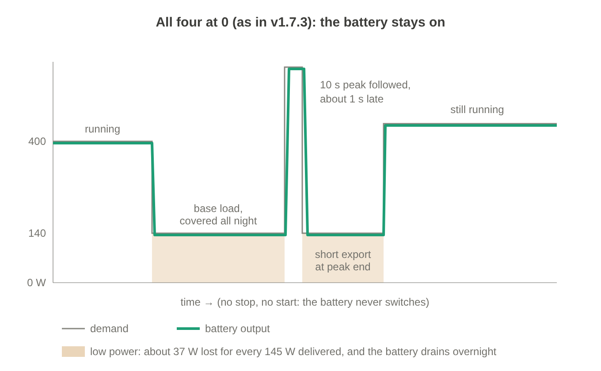
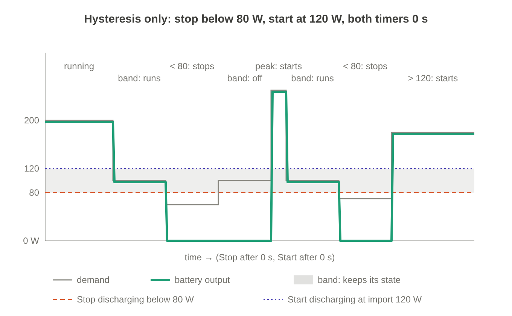
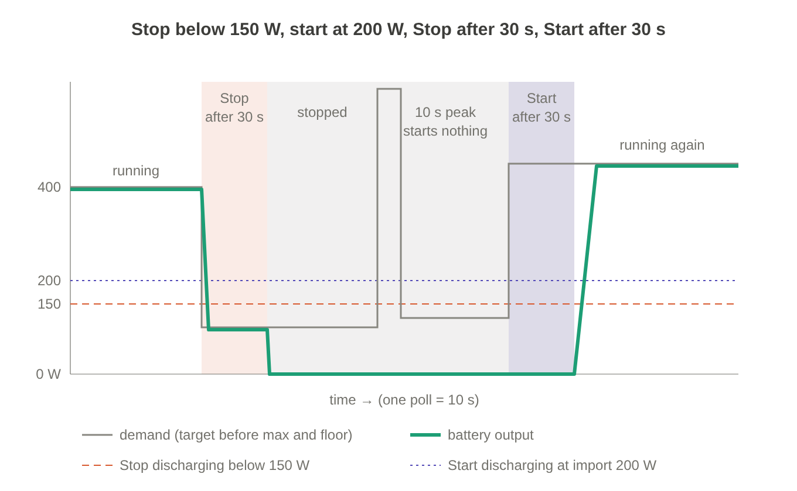
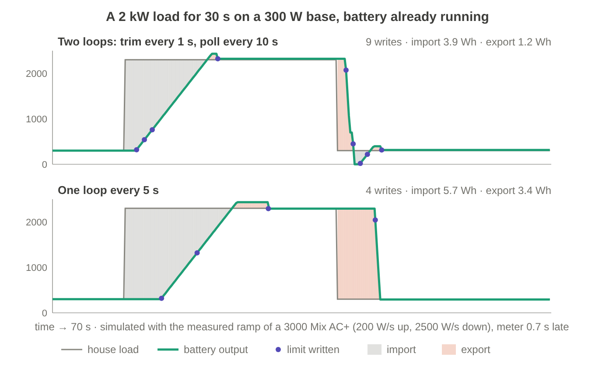
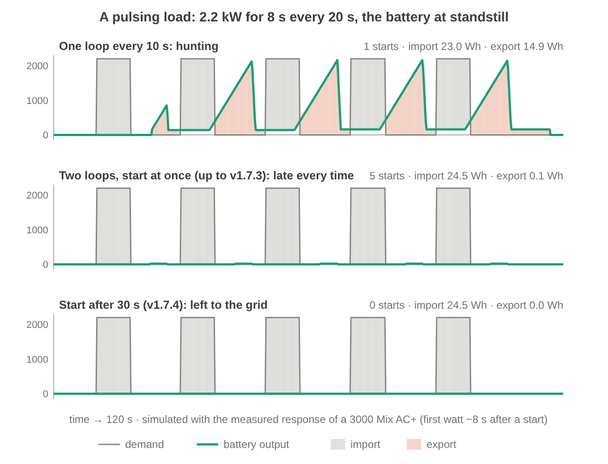

# Low demand, short peaks and hunting

How the integration decides when a battery stops and starts at low demand, why it waits on both sides, how it avoids hunting after short peaks, why it runs two control loops instead of one, and where the conversion loss is taken into account. Measured on a SolarFlow 3000 Mix AC+; the reference is [README2](../README2.md#stopping-at-low-demand).

## Contents

- [The problem at low demand](#the-problem-at-low-demand)
- [Always on](#always-on)
- [Hysteresis alone](#hysteresis-alone)
- [A timer on both sides](#a-timer-on-both-sides)
- [The settings and their defaults](#the-settings-and-their-defaults)
- [Why 50 W both ways](#why-50-w-both-ways)
- [Two loops instead of one](#two-loops-instead-of-one)
- [Short peaks and hunting](#short-peaks-and-hunting)
- [Not flooding the battery](#not-flooding-the-battery)

## The problem at low demand

A battery converter has a fixed loss while it runs: about 33 W discharging and about 44 W charging, whatever it delivers, plus a few per cent. At rest, with both limits at 0 and `smartMode` handed back, the 3000 Mix AC+ draws about 5 W. Below a few hundred watts the fixed part dominates: discharging 150 W takes about 187 W from the cells, and charging 50 W brings next to nothing into the pack.

The example house: a night base load between 120 and 150 W, and a boiling-water tap (a Quooker) that reheats on its own at 2.2 kW for about 10 seconds, every 20–30 minutes at night and every 7–25 minutes in the morning. On the 1 Hz P1 reading it is a clean block: +2.2 kW for 9–10 s, then gone. From standstill the battery needs 6 to 15 seconds before it delivers its first watt, so it can never serve such a peak from standstill; every start for one is pure cost.

## Always on

With no stop limit the battery never switches at night. The tap is no problem: the running battery follows the 10-second peak about 1 second late, with a short export blip when it ends, and at 2 kW that conversion is efficient. The cost is elsewhere: the battery covers the base load all night at its worst efficiency, about 182 W out of the pack for every 145 W delivered, roughly 1.6 kWh over a 9-hour night of which about 0.3 kWh is conversion loss. With net metering, standby is the better choice for those hours; without it, a day plan or planner decides from the prices.

## Hysteresis alone

Stop below a level, start above a higher one, both at once (both timers at 0). Put the band where it matters, just above the base load: stop below 150 W, start at 200 W. Then every reheat of the tap goes above 200 W and starts the battery at once; by the time the battery delivers, the tap is done, the demand is back at 140 W, under 150 W, and it stops again. One useless start-stop cycle per reheat: about 20 a night, and 17 in three morning hours. A band below the base load (say 80/120 W) does not have this problem, but it never stops at night either, so it saves nothing. Inside the band the battery keeps whatever state it has, and a short peak decides that state.

## A timer on both sides

The battery stops only after the demand has stayed under the limit for `Stop after` seconds, and starts only after it has stayed above the threshold for `Start after` seconds. The tap's 10 seconds never reach 30, so it starts nothing. Replayed on a recorded night (9.7 hours at 1 Hz, stop limit 150 W): 19 stops with a 10 s timer, 4 with 30 s, 3 with 60 s. The battery then rests for about 6 of those hours, at 5 W instead of around 37 W of conversion loss. What the tap costs from the grid instead: about 6 Wh per reheat, roughly 0.12 kWh a night, which the battery could not have covered anyway.

So of the three: always on drains the battery at its worst efficiency, hysteresis alone switches on every short peak for nothing, and a timer on both sides rests through the night and lets the short peaks come from the grid. A level is needed for how little is too little, a time for how short is too short.

## The settings and their defaults

| Setting | Default | |
|---|---|---|
| `Stop discharging below` | 50 W | 0 = off |
| `Stop charging below` | 50 W | 0 = off; on a dynamic contract from 2027, 80 W ([why](#why-50-w-both-ways)) |
| `Stop after` | 30 s | how long the demand stays under the limit before the battery stops (on a cluster 10–120 s) |
| `Start after` | 30 s | how long the demand stays above the threshold before the battery starts (on a cluster 10–120 s) |

- The threshold for a start is always the larger of the start threshold (`Start discharging at import`, `Start charging at export`) and the stop limit: a start below the stop limit would only stop again. That also holds after a restart of Home Assistant, when the controller knows of no stop of its own.
- A stop writes both limits to 0 in one request; the battery then rests at about 5 W.
- Only the smart modes (`smart_matching`, `smart_charge_only`, `smart_discharge_only`). Manual, quick, standby and Price Control's day plan ignore it.
- In a cluster the primary stops, and only while it works alone below `Concentrate below`; the cluster's own `Start after` also holds the secondaries back on a short peak. See [docs/cluster.md](cluster.md#how-it-regulates).
- Hysteresis is the same settings with both timers at 0, for example stop below 80 W and start at 120 W. That works in a house without short peaks.
- All at 0 is how it worked before v1.7.4.

## Why 50 W both ways

The controller steers on AC watts at the plug: demand, limits and thresholds are all AC. It adds no loss of its own; the limits are where the loss is taken into account.

| AC at the plug | Discharging: from the cells | Charging: into the cells |
|---|---|---|
| 50 W | ~84 W (60 %) | ~4 W (8 %) |
| 80 W | ~115 W (70 %) | ~33 W (41 %) |
| 100 W | ~136 W (74 %) | ~53 W (53 %) |
| 150 W | ~187 W (80 %) | ~101 W (67 %) |

Discharging: cells = 1.027 × AC + 32.9 W, a least-squares fit over 33 still pairs. Charging: a fixed ~44 W from an independent measurement on the same model on the DC side, with the proportional part fitted to our own 3 kW point (2856 W into the cells of 2999 W AC).

- **Discharging below 50 W** costs in every season: less than two thirds of what leaves the pack reaches the house. 50 W lies under the base load of nearly every house, so a day plan that lets the battery cover the base load is not in the way. Between 50 and 150 W it depends on prices: from 2027 a battery covering a 145 W night load still delivers about 80 % of what it draws, which beats importing at full price while exporting earns little; whether that energy is better kept for the evening peak is a question for a planner, not for a power band. To rest through a quiet night, set the limit just above the base load.
- **Charging below 50 W** stores next to nothing: at 50 W about 8 % reaches the cells. Between 50 and 80 W it depends on what exporting earns. On a fixed-price contract with feed-in costs an exported kWh earns next to nothing, so even 8 % is worth storing; that is why the default is 50 W. On a dynamic contract from 2027 a kWh charged at 80 W is worth about 0.41 × 0.8 × the import price later, about as much as exporting it now; below that exporting is better, so set *Stop charging below* to 80 W there.

## Two loops instead of one

After a write, the battery takes 3 to 8 seconds before the grid shows the result: about 3 s for a stop, about 8 s for a start, measured on the meter. A single control loop is stuck with that: run it faster and it corrects again before the previous correction has landed; run it slower and it is too late to follow the load. That is also why Zendure's own energy manager in the app adjusts only about every 20 seconds.

The integration splits it in two:

- **The mode loop** runs on every battery poll (10 s by default). It is the only one that may start, stop or reverse a direction, and it resets against what the battery actually reports.
- **The trim loop** runs on every meter sample (1 s with the Zendure P1, down to 250 ms with a direct P1 reader). It only adjusts the limit within the running direction, and books what it has already ordered, so it never asks twice for the same watts.

The picture shows one load step, simulated with the measured ramp of a 3000 Mix AC+ (200 W/s up, 2500 W/s down) and a meter 0.7 s behind. At the start it is the ramp, not the loop, that sets most of the import; the difference is in the export when the load stops: the 5 s loop keeps delivering 2 kW for up to 5 s after the load is gone.

| | Writes | Import | Export |
|---|---|---|---|
| Two loops (trim every 1 s, poll every 10 s) | 9 | 3.9 Wh | 1.2 Wh |
| One loop every 5 s | 4 | 5.7 Wh | 3.4 Wh |

## Short peaks and hunting

Hunting is a battery that keeps answering a situation that has already passed. Its cause is the start: from standstill a battery needs 6 to 15 seconds before it delivers its first watt (about 8 s on a 3000 Mix AC+). A load that lasts less than that — a kettle tap reheating, a coffee machine heating in bursts, a compressor starting — is over before the battery arrives.

- **One loop.** A controller that corrects every few seconds on the last reading delivers the peak when the load is already off, exports during every pause, and is out of phase for as long as the pulses go on. Measured with a 1700 W coffee machine before v1.1.0: +1750, −1700, +1550, −1500 W across 80 seconds.
- **Two loops, starting at once** (up to v1.7.3). The trim loop books what it has already ordered and lowers the limit as soon as the meter shows the load has gone, so the export stays small. But the battery still starts for every pulse, and arrives late every time: every start is a relay switch and a few seconds of conversion loss for nothing.
- **Start after** (since v1.7.4). A direction starts only once the demand has stayed past its threshold for `Start after` seconds (30 s by default). A shorter peak is left to the grid; the battery starts only for a load that stays.

The same pulsing load in all three, simulated with the measured response of a 3000 Mix AC+:

| | Starts | Import | Export |
|---|---|---|---|
| One loop every 10 s | 1, then hunting | 23.0 Wh | 14.9 Wh |
| Two loops, start at once | 5 | 24.5 Wh | 0.1 Wh |
| `Start after` 30 s | 0 | 24.5 Wh | 0 Wh |

Starting at once bought nothing: the same 24.5 Wh from the grid as not starting at all, plus five relay switches. A running battery is different: it follows a peak about one second late in its own direction, which is efficient at high power, with a short export when the peak ends.

**By design: cooking comes from the grid.** `Start after` counts continuous demand: every pause starts its time again. A load that pulses with pulses shorter than `Start after` — an induction hob at half power, cycling 10 s on and 10 s off — therefore never starts the battery and comes from the grid as a whole, like the tap. That is deliberate: from standstill the battery is late for every pulse, and each start costs a relay switch and conversion loss that the few watt-hours it could cover do not make up. In smart matching the battery is there to take the solar surplus, and to cover the house where it can do so efficiently; when to discharge for large loads is better left to a day plan or a planner that knows the prices. Set `Start after` lower if you want such a load covered anyway.

**Seeing it on your own installation.** Two measured diagnostics count what happens: *Skipped peaks*, the starts that `Start after` held back and that never came (per direction, with the energy the grid gave meanwhile and the longest), and *Relay switches*, the starts from standstill and changes of direction the battery did make, with the *short* runs that stopped or turned again within 2 minutes. Many short runs mean hunting; with `Start after` they should be rare.

## Not flooding the battery

- The trim loop is tied to the meter: it runs once per meter sample, so it can never write faster than the P1 reports.
- It writes only when the correction exceeds `Trim threshold` (40 W by default); the mode loop only above `Mode threshold` (10 W). Measured over four hours: about one write every 8 seconds on average, not one per sample.
- Values that belong together go in one request: direction, limits and the RAM flag. A request takes 23–31 ms on a 3000 Mix AC+.
- Every smart and quick mode writes with `smartMode` 1, so the frequent limit changes stay in RAM and never touch flash. Standby clears both limits and hands `smartMode` back to 0 last, which lets the inverter drop to its ~5 W rest state.
- The integration counts writes that never show up in the device's report (*Lost writes*); on the reference battery a handful in total, not a pattern.
- Older or slower models may need gentler settings: the battery poll, both thresholds, the trim strength and the meter interval are settings per device, with safe defaults.

---

Part of [Zendure RestAPI for Home Assistant](https://github.com/windsurf/hassio-zendure-restapi), licensed under the [Apache License 2.0](../LICENSE) since v1.7.0 (MIT for v1.6.x and earlier); see [NOTICE](../NOTICE). Zendure and SolarFlow are trademarks of their respective owners; this project is not affiliated with or endorsed by Zendure.
